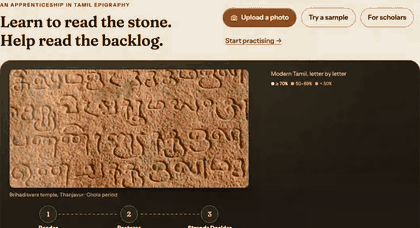
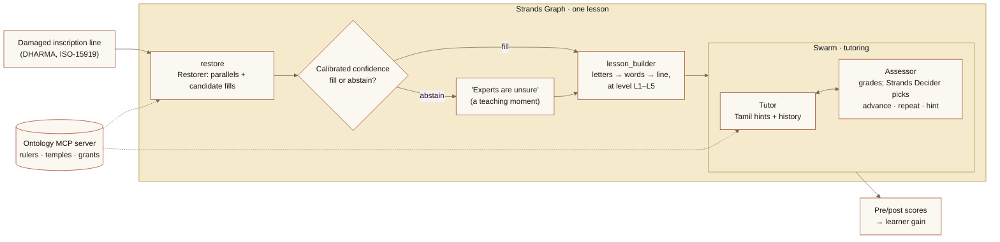
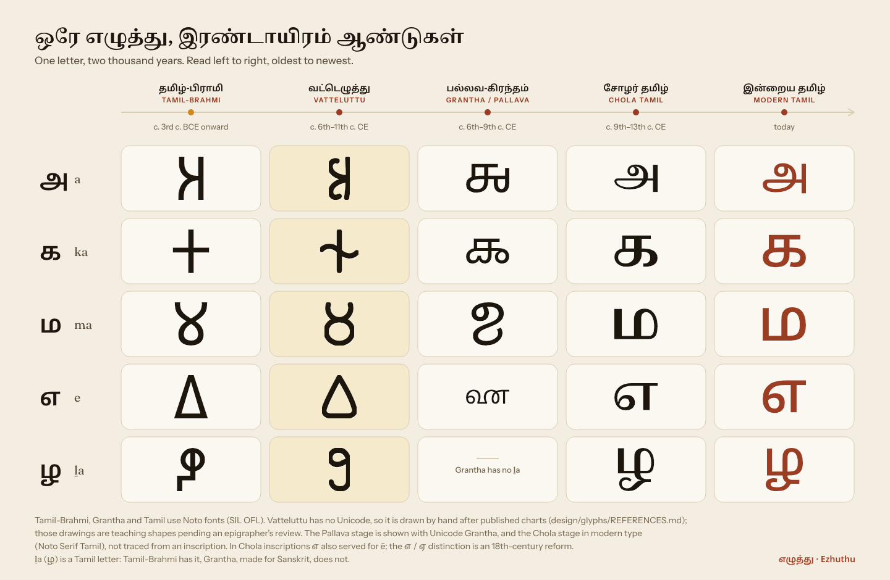
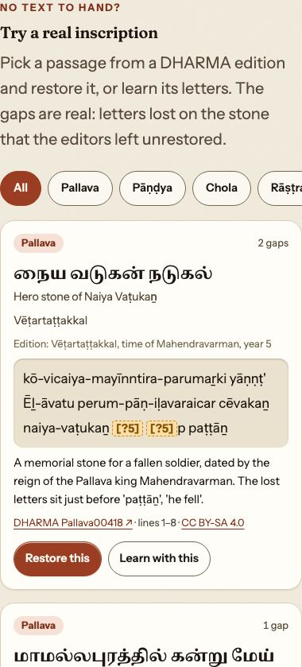

<picture>
  <source media="(prefers-color-scheme: dark)" srcset="design/brand/banners/readme-hero-dark.png">
  
</picture>

<p align="center">
  <a href="https://github.com/Vivek0712/ezhuthu/actions/workflows/ci.yml"></a>
  <a href="LICENSE"></a>
  <a href="https://strandsagents.com"></a>
  <a href="https://aws.amazon.com/bedrock/agentcore/"></a>
  <a href="https://dharmalekha.info"></a>
  <a href="https://huggingface.co/sparrow-decider/ezhuthu-sparrow-decider-2b"></a>
  
</p>

<p align="center"><b>An apprenticeship tool for Tamil epigraphy, built with Strands Agents.</b><br>
It teaches Tamil learners to read their own temple inscriptions, in Tamil, from today's letters back to Tamil-Brahmi.<br>
<span lang="ta">உங்கள் ஊர்க் கோயில் கல்வெட்டை நீங்களே படியுங்கள்.</span></p>

<p align="center"><b><a href="https://ezhuthu.sparrowdecider.com">Open the live app</a></b> ·
<a href="https://ezhuthu.sparrowdecider.com/">Home</a> ·
<a href="https://ezhuthu.sparrowdecider.com/practice">Practice</a> ·
<a href="https://ezhuthu.sparrowdecider.com/restore">Restore</a> ·
<a href="https://ezhuthu.sparrowdecider.com/how-it-works">How it works</a> ·
<a href="https://ezhuthu.sparrowdecider.com/benchmark">Benchmark</a><br>
<sub>Also served at <a href="https://d3jz2k92ne5puo.cloudfront.net">d3jz2k92ne5puo.cloudfront.net</a>.</sub></p>

<p align="center"></p>

<p align="center"><sub>Reader → Restorer → confidence check → Interpreter, on a real photograph of a Chola-period stone at Thanjavur
(<a href="app/web/public/hero/ATTRIBUTION.md">photo credit</a>). The percentages are the models' own confidence, not a measured accuracy.
Still frame: <a href="design/brand/banners/hero-stone-poster.png">PNG</a>.</sub></p>

Ezhuthu (எழுத்து, "letter") works the way an apprentice learns from a master epigraphist: you read real, damaged
inscriptions letter by letter, at five levels (modern Tamil, Chola Tamil, Pallava (Grantha), Vatteluttu and
Tamil-Brahmi), with hints, history and feedback in Tamil. Where the stone is broken, a restoration engine proposes the
missing letters with a calibrated confidence. When it is unsure, it says so and leaves the gap open for an expert, and
that becomes part of the lesson: *experts are unsure here too*.

## What it does

| Page | What you can do |
| --- | --- |
| **Home** | Watch one letter change across 2,000 years, then try one of 13 real passages from DHARMA editions: ten hide a span that the editors restored, three have letters no edition restores. |
| **Practice** | Short drills on letters, words, formulae and gaps from real editions, plus a guided lesson and a pre-test / post-test that reports your gain in letters read and your time per letter. |
| **Restore** | Paste a damaged line (or upload a photo for the Reader to transcribe). The Restorer proposes fills with parallels from other inscriptions, fills or abstains on a calibrated threshold, and shows what the published edition reads when there is one. Experts can sign in to review abstentions and corrections. |
| **How it works** | An animated walk through the agents, the ontology and the evaluation, in Tamil and English. |
| **Benchmark** | The restoration benchmark and every number below, with links to the reports. |

## Why it matters

- **Underserved learners.** Tamil-medium school and college students, rural heritage guides and self-learners mostly cannot read the inscriptions on their own village temples, and there has been no tool that teaches old Tamil scripts *in Tamil*. In 2021 India had about 23 epigraphists; of nearly 1 lakh (100,000) inscriptions found since 1886, only 30,000 to 35,000 had been deciphered and published ([The Federal, 3 Aug 2021](https://thefederal.com/news/inscriptions-languish-as-the-number-of-epigraphists-dwindles)).
- **Real, damaged texts.** The corpus is **1,320** DHARMA inscriptions, of which **65%** are damaged ([data card](benchmark/DATA_CARD.md)). Damage is the normal case, so a reading tutor has to handle it honestly.
- **Feedback in the learner's first language.** Hints, explanations and history (ruler, temple, grant) are in Tamil. English is optional.
- **Honest about uncertainty.** The app never presents a restoration as settled. A fill is shown as matching the editors' restoration, differing from it, or left open for an expert.

## Results

Every number here is copied from a report in [`eval/reports/`](eval/reports/) or from
[`benchmark/stats.json`](benchmark/stats.json), and `tests/test_doc_numbers.py` checks them against those files.
"Matches the editors' restoration" means the fill equals the DHARMA editor's supplied text after normalisation. It is
not a claim that the fill is what the stone said.

| What we measure | Number | Source |
| --- | --- | --- |
| Expert restorations in the benchmark | **3,289** (test **413**, test-hard **317**) | [benchmark/DATA_CARD.md](benchmark/DATA_CARD.md) |
| Restorations in inscriptions over 1,100 years old (Pallava collection only) | **410** (age set with Uttiramerur: **419**) | [benchmark/DATA_CARD.md](benchmark/DATA_CARD.md) |
| Fills that match the expert restoration (top-1, test, the deployed cloud configuration: routed LLMs + 5-gram pre-rank, no decider) | **62.7%** (259 of 413); at its VAL-calibrated threshold it fills **49.9%** of test gaps, and **90.8%** of those fills match | [deployed config](eval/reports/2026-11-02-deployed-config.md) |
| Fills that match the expert restoration (top-1, test, measured with the local 2B decider) | **49.6%** (205 of 413; copy-from-parallel baseline 47.2%, character 5-gram baseline **56.7%**) | [test eval](eval/reports/2026-11-02-test-eval.md) |
| Calibration (ECE) and coverage at the abstain threshold (local 2B decider, VAL calibration) | ECE **0.113**; fills **46.5%** of test gaps, and **63.5%** of those fills match the expert | [test eval](eval/reports/2026-11-02-test-eval.md) |
| Learner gain, pre-test to post-test | **TBD**: the pilot with student volunteers has not been run yet; we do not estimate | [eval/reports/](eval/reports/) |

### The deployed restorer on TEST (413 gaps, scored once)

The configuration the live app runs was chosen on the validation split by a rule committed before any variant was
scored ([pre-registration](eval/reports/2026-11-02-deployed-config/preregistration.md)), calibrated on validation,
and scored once on TEST ([report](eval/reports/2026-11-02-deployed-config.md)).

| System (TEST, 413 gaps) | Top-1 match [95% CI] | Matches | ECE | Coverage | Selective accuracy |
| --- | --- | --- | --- | --- | --- |
| **Deployed: Sonnet 4.6 → Opus 4.6, noisy-OR pre-rank with the 5-gram, Platt-calibrated** | **0.6271** [0.5787, 0.6731] | 259 / 413 | 0.1103 | 0.4988 | 0.9078 (187/206) |
| Character 5-gram baseline | 0.5666 [0.5182, 0.615] | | 0.1611 | 0.3705 | 0.9020 (138/153) |
| Copy the best parallel passage | 0.4722 [0.4237, 0.5206] | | 0.0771 | 0.1622 | 0.7761 (52/67) |
| Sonnet 4.6 alone ([test eval](eval/reports/2026-11-02-test-eval.md), ranked by the local 2B decider) | 0.4165 [0.3705, 0.4649] | | 0.1497 | 0.1574 | 0.8154 (53/65) |

- **Against the baselines** (paired exact McNemar on the same gaps): 34 vs 9 discordant gaps against the 5-gram
  (p = 0.0002) and 88 vs 24 against copy (p < 0.0001).
- **Test-hard subset** (317 gaps): top-1 0.5741 [0.5205, 0.6278], coverage 0.4101, selective accuracy 0.9077.
- **By gap length** (Tamil letters):

  | System | 1 letter (n=281) | 2-3 letters (n=81) | 4+ letters (n=51) |
  | --- | --- | --- | --- |
  | Deployed | 0.7367 | 0.5185 | 0.1961 |
  | Character 5-gram | 0.6797 | 0.4321 | 0.1569 |
  | Copy baseline | 0.5445 | 0.3951 | 0.1961 |

- **Cost and latency** (list prices, an estimate): 122 Sonnet + 297 Opus calls for the 413 gaps, $0.0060 per gap;
  latency per gap p50 3.2 s, p90 5.5 s.

**What the test evaluation says** (413 test gaps, scored once with settings chosen on the validation split; [report](eval/reports/2026-11-02-test-eval.md)). **These numbers were measured with the local strands-decider-2B and its VAL calibration, a configuration the cloud runtime never ran; the configuration it does run was chosen afterwards on VAL by a pre-registered rule, calibrated on VAL and scored once on test: Sonnet 4.6 escalating to Opus 4.6 with the character 5-gram as a pre-rank feature and no decider matches the expert on 62.7% of test gaps, above the 5-gram alone (p = 0.0002; [deployed config](eval/reports/2026-11-02-deployed-config.md)).** The measured pipeline (Sonnet 4.6, escalating to Opus 4.6) is not significantly better than copying the best parallel passage (p = 0.27), and a character 5-gram model beats both (p = 0.012 against the pipeline). Most test gaps are a single letter (68%); on gaps of 4 or more letters every system matches the expert on at most 1 in 3. Escalating to Opus matters (Sonnet alone: 41.6%). The 2B Strands Decider ranks candidates no better than the decider-free pre-rank on these gaps, and the ontology hints made no measurable difference. These are the honest starting numbers for the restoration engine, not a claim that it reads inscriptions like an epigraphist.

### Reading photos (OCR)

The Reader turns a photo or scan into letters ([report](eval/reports/2026-11-02-ocr-eval.md)). Character error rate
(CER, lower is better):

| Input | CER |
| --- | --- |
| Tamil script, 72 synthetic plates from DHARMA TEST lines (clean / photo-like / weathered) | 0.097 (0.047 / 0.052 / 0.192) |
| Real printed Tamil pages (3) | 0.093 |
| Grantha, synthetic | 0.56 |
| Tamil-Brahmi, real photos of the Jambai inscription (3) | 0.83 to 0.91 |
| Tamil-Brahmi, synthetic | 0.80 |

Vatteluttu is not measured: it has no Unicode encoding, so nothing could be rendered, and we found no openly licensed
photograph with a published reading. The app marks every photo reading as one to check against the edition, and warns
on Tamil-Brahmi, Vatteluttu and Grantha.

### A fine-tuned Strands Decider for restoration

We fine-tuned the 2B Strands Decider on the restorer's own decision ("which of the top 3 candidate fills, or none,
matches the editors"), on TRAIN only, chosen and calibrated on VAL and scored once on TEST
([report](eval/reports/2026-11-02-finetuned-decider.md)). The weights are public on Hugging Face:
**[sparrow-decider/ezhuthu-sparrow-decider-2b](https://huggingface.co/sparrow-decider/ezhuthu-sparrow-decider-2b)** (Apache-2.0, with the model card, an example request and the
checksums).

| TEST, 413 gaps (Sonnet 4.6 candidates) | Top-1 match |
| --- | --- |
| Restorer ranked by the fine-tuned decider | **0.6538** (270/413, 95% CI 0.6077-0.6973) |
| Same candidates, decider-free pre-rank | 0.5908 (32 vs 6 discordant, p = 2.4e-5) |
| Decider only, top 3 + none: fine-tuned vs hosted v19 | **0.5472** vs 0.4310 (53 vs 5 discordant, p < 1e-8) |

It uses a different candidate set from the routed restorer in the table above, so the two top-1 numbers are not a
like-for-like comparison. On the frozen 60-item TEST-hard benchmark (an older request format) it does not win: 0.400,
tied with Sonnet self-confidence and below hosted v19 (0.450).

**Where it runs:** the hosted Strands Decider service serves it as `ezhuthu-strands-2b-ft` next to the general model,
on the same instances. `main` routes restoration through it (`restorer.strategy_llm: choice-topk` in
[`config/models.yaml`](config/models.yaml), [#47](https://github.com/Vivek0712/ezhuthu/pull/47)), falling back to the
pre-rank when the decider is unavailable or the request is short of time; the live app picks this up at its next
deploy. A one-gap restore takes about 15 s with the decider call, against about 3.4 s with the pre-rank
([live check](eval/reports/2026-11-03-hosted-ft-live.md)).

## Honest limits

- **Tamil-Brahmi photos are not readable** by the Reader (CER 0.83 to 0.91 on real photos). The Tamil-Brahmi level
  teaches from edition text and drawn letters, not from photos.
- **Long gaps are hard.** On gaps of 4 or more letters the deployed restorer matches the editors on 0.1961 of test
  gaps, about 1 in 5, no better than copying the best parallel passage.
- **The ontology hints had no measurable effect** on restoration (3 gaps gained, 3 lost, p = 1.0; [test eval](eval/reports/2026-11-02-test-eval.md)).
  The ontology still supplies the history (rulers, temples, grants) shown in lessons and readings.
- **The Context Ontology Accelerator (COA) store was prepared but not run** ([ontology/COA.md](ontology/COA.md)): no
  ontology was induced with it.
- **Tamil strings are pending a native-speaker review** ([docs/marketing/positioning.md](docs/marketing/positioning.md)),
  and the drawn Vatteluttu glyphs are teaching shapes pending an epigrapher's review ([sources](design/glyphs/REFERENCES.md)).
- **Learner gain is not measured yet.** The pre-test and post-test are built; the pilot has not run.

- **One request has a 25 s budget.** For the deployed restorer, its latency is measured per gap (test p90 5.5 s), but the 27 s proxy limit applies per request, so the restorer restores at most 8
  gaps per request, skips the Opus escalation or the LLM call when time runs short, and leaves the remaining gaps open
  with an `abstain_reason` instead of timing out ([#41](https://github.com/Vivek0712/ezhuthu/issues/41),
  [report](eval/reports/2026-11-02-request-budget.md)). The 5-gram is built at start-up, not on the first request.

## How it works



**Agents** (all built with [Strands Agents](https://strandsagents.com), in [`src/ezhuthu/agent/`](src/ezhuthu/agent/)):

- **Lesson flow:** a Strands **Graph** runs `restore` → `lesson_builder` → a **Swarm** of **Tutor** and **Assessor**
  ([`tutor/graph.py`](src/ezhuthu/agent/tutor/graph.py)). The hosted Strands Decider makes the tutor's advance /
  repeat / hint decision; without its key, rules decide and the app says so.
- **Reader:** photo or file to letters, with per-letter confidence ([`reader.py`](src/ezhuthu/agent/reader.py)).
- **Restorer:** Strands tools `retrieve_parallels`, `propose_fills`, `check_constraints`, `rank_and_decide` and
  `ontology_hints` ([`tools.py`](src/ezhuthu/agent/tools.py), [`restorer.py`](src/ezhuthu/agent/restorer.py)).
  Claude Sonnet 4.6 proposes fills first; a gap goes to Claude Opus 4.6 when Sonnet's best candidate scores under
  0.6, the gap is longer than 12 letters, or there is no good parallel. Candidates are pre-ranked by a noisy-OR of the
  parallel evidence, the LLM's score and the character 5-gram's share, and the top score is Platt-calibrated on the
  validation split to decide fill or abstain.
- **Interpreter:** letters in; words, a modern Tamil phrase and a plain meaning out ([`interpreter.py`](src/ezhuthu/agent/interpreter.py)).
- **Decisions:** Restoration (deployed): a decider-free pre-rank with the character 5-gram's score ranks the candidates, with no decider call; Strands Decider makes the tutor's advance / repeat / hint decision.
  On `main`, the fine-tuned Strands Decider ([sparrow-decider/ezhuthu-sparrow-decider-2b](https://huggingface.co/sparrow-decider/ezhuthu-sparrow-decider-2b)) picks among the
  pre-rank's top 3 candidates or none, with the pre-rank as the fallback; the live app picks this up at its next deploy.
- **Model IDs** come only from [`config/models.yaml`](config/models.yaml).

**Ontology:** an OWL ontology of rulers, titles, places, grants, measures and formulae, with 27 classes, 21 object
properties and 1,958 named individuals ([`ontology/`](ontology/README.md)), served to the agents by our own MCP server ([`mcp_server.py`](src/ezhuthu/ontology/mcp_server.py)).

**Cloud** (AWS CDK in [`infra/`](infra/README.md)):

```
Browser ──> CloudFront ──┬── /*      ──> S3 (private)  React app
                         └── /api/*  ──> API Gateway HTTP API ──> Lambda proxy ──┬──> Amazon Bedrock AgentCore Runtime
                                          (Cognito JWT on                         │     (Strands agents + ontology MCP server)
                                           expert routes)                         ├──> DynamoDB (sessions, review queue)
                                                                                  └──> Secrets Manager (hosted decider key)
```

| Layer | What | Where |
| --- | --- | --- |
| Corpus + benchmark | DHARMA TEI/EpiDoc parsing, script conversion (Aksharamukha), restoration benchmark | `src/ezhuthu/corpus/`, `benchmark/` |
| Ontology | OWL ontology, lookups, MCP server | `src/ezhuthu/ontology/`, `ontology/` |
| Agents | Graph + Swarm, Reader, Restorer, Interpreter | `src/ezhuthu/agent/` |
| Evaluation | Benchmark harness, baselines, calibration, OCR evaluation | `src/ezhuthu/eval/`, `eval/reports/` |
| API | FastAPI, following [`contracts/restore-api.md`](contracts/restore-api.md) | `src/ezhuthu/api/` |
| Runtime | Amazon Bedrock AgentCore Runtime, infrastructure in CDK | `infra/` |
| App | React + Vite, Tamil-first and bilingual, mobile-first | `app/web/` |
| Design system | Brand, tokens, glyph art, UX spec | [`design/`](design/README.md) |

<p align="center"></p>

<p align="center"><sub>One letter, five stages. Vatteluttu has no Unicode, so it is drawn (<a href="design/glyphs/REFERENCES.md">sources and review status</a>).</sub></p>

## Screenshots

| Home (Tamil) | Restore with confidence and abstain | Sample gallery |
| --- | --- | --- |
|  |  |  |

## Quick start

Python 3.12 with [uv](https://docs.astral.sh/uv/), Node 22.

```bash
make setup            # Python 3.12 venv with uv, editable install with dev extras
make data             # fetch DHARMA at the pinned commit into data/raw/ (gitignored)
make check            # ruff + pytest + design checks (no live model calls; live tests need EZHUTHU_LIVE=1)

# API (all endpoints in contracts/restore-api.md); live model calls need AWS credentials with Bedrock access
.venv/bin/uvicorn ezhuthu.api.app:app --port 8080

# Web app with mocked API responses (no AWS needed); the mocks replay recorded live answers
cd app/web && npm ci && npm run dev
```

To deploy your own copy on AWS, follow [`infra/README.md`](infra/README.md).

## Data and licences

- **Inscription texts:** [DHARMA](https://dharmalekha.info), "The Domestication of 'Hindu' Asceticism and the Religious Making of South and Southeast Asia" (ERC grant 809994), and the named editors of each edition. Edition files declare **CC BY-SA 4.0** (1,249 of 1,320; the other 71 have no licence in their header and fall under their DHARMA repository licence, Creative Commons Attribution 4.0). The derived **benchmark is shared under CC BY-SA 4.0**, with attribution to DHARMA ([benchmark/LICENSE](benchmark/LICENSE), [data card](benchmark/DATA_CARD.md)). The Tamil Lexicon is used for lookups only. No scraped data.
- **Code:** [Apache-2.0](LICENSE). See [NOTICE](NOTICE).
- **Images:** the home hero photograph is by Richard Mortel, CC BY 2.0 ([attribution](app/web/public/hero/ATTRIBUTION.md)); the sample images are our own synthetic renders of DHARMA text, CC BY-SA 4.0 ([attribution](app/web/public/samples/ATTRIBUTION.md)); images used in the OCR evaluation are downloaded, not committed, with their licences recorded in [`eval/ocr/real_images.json`](eval/ocr/real_images.json).
- **Fonts:** Noto Serif/Sans Tamil, Noto Sans Brahmi, Noto Sans Grantha, Fraunces and Instrument Sans, all under the SIL Open Font License 1.1 ([design/brand/FONTS.md](design/brand/FONTS.md)).
- **Restorations** are described as matching, or differing from, the editors' restoration. Drawn Vatteluttu glyphs are teaching shapes pending an epigrapher's review.

## Contributing and security

See [CONTRIBUTING.md](CONTRIBUTING.md). Please report security issues privately as described in [SECURITY.md](SECURITY.md).

## Credits

- The **DHARMA** project and the editors of every edition used here, whose restorations are the benchmark.
- [Strands Agents](https://strandsagents.com) and [Strands Decider](https://huggingface.co/StrandsAgents/strands-decider-2B-qwen3.5-v1-2610) (the base of our fine-tune), Amazon Bedrock and Amazon Bedrock AgentCore.
- Richard Mortel for the Thanjavur photograph, and the Noto, Fraunces and Instrument Sans font projects.
- Built by Vivek Raja for the hackathon's Education track.

<p align="center"><br><sub>எழுத்து · Ezhuthu</sub></p>
