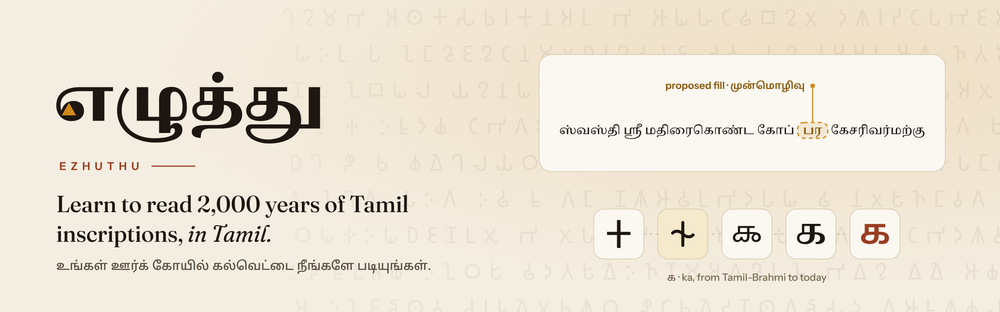
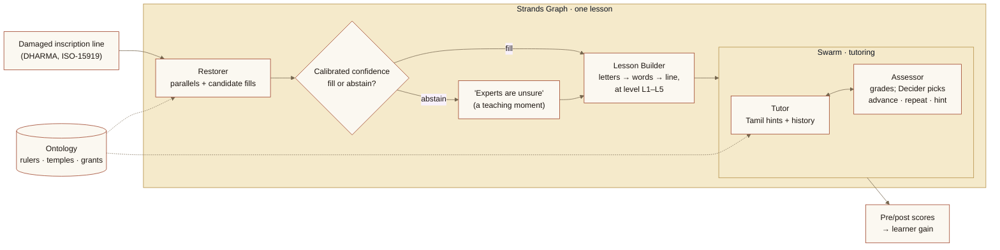
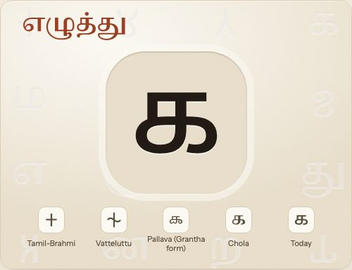
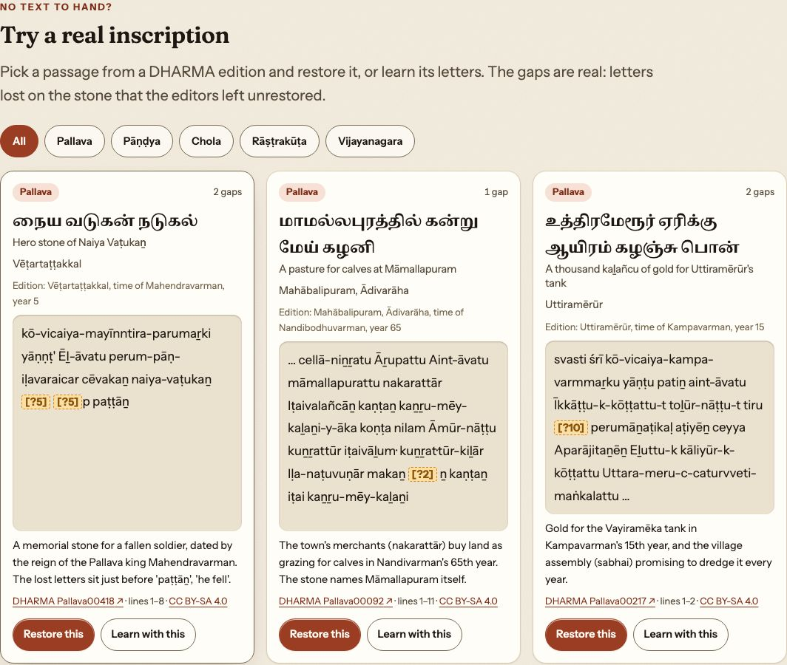
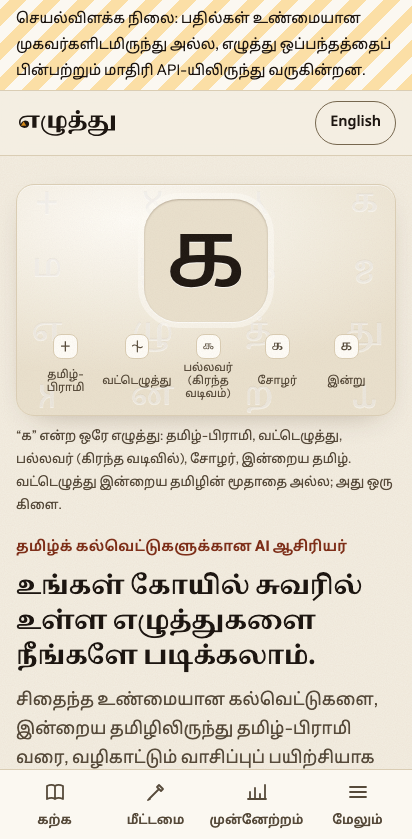
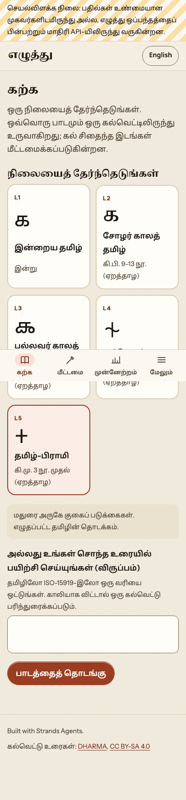
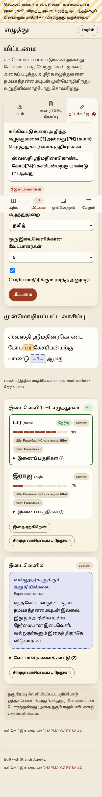
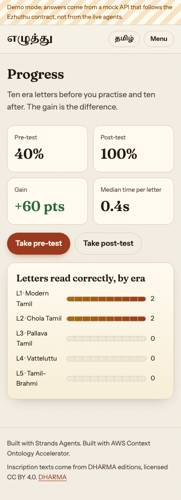

<picture>
  <source media="(prefers-color-scheme: dark)" srcset="design/brand/banners/readme-hero-dark.png">
  
</picture>

<p align="center">
  <a href="https://github.com/Vivek0712/ezhuthu/actions/workflows/ci.yml"></a>
  <a href="LICENSE"></a>
  <a href="https://strandsagents.com"></a>
  <a href="https://aws.amazon.com/bedrock/agentcore/"></a>
  <a href="https://dharmalekha.info"></a>
  
</p>

<p align="center"><b>An AI tutor that teaches Tamil learners to read their own temple inscriptions, in Tamil, from today's letters back to Tamil-Brahmi.</b><br>
<span lang="ta">உங்கள் ஊர்க் கோயில் கல்வெட்டை நீங்களே படியுங்கள்.</span></p>

Ezhuthu (எழுத்து, "letter") turns real, damaged inscriptions into guided reading lessons at five levels: modern Tamil, Chola Tamil, Pallava (Grantha), Vatteluttu and Tamil-Brahmi. Its restoration engine proposes the missing letters with calibrated confidence. When it is unsure, it says so, and that becomes part of the lesson: *experts are unsure here too*.

Built with [Strands Agents](https://strandsagents.com) and Strands Decider. It runs on Amazon Bedrock AgentCore. Inscription texts come from [DHARMA](https://dharmalekha.info) (CC BY-SA 4.0).

> **Status:** hackathon build (Education track), under active development. Every number below links to its source. **TBD** means the evaluation has not been published yet; we do not estimate.

## Why it matters

- **Underserved learners.** Tamil-medium school and college students, rural heritage guides and self-learners mostly cannot read the inscriptions on their own village temples, and there has been no tool that teaches old Tamil scripts *in Tamil*. In 2021 India had about 23 epigraphists; of nearly 1 lakh (100,000) inscriptions found since 1886, only 30,000 to 35,000 had been deciphered and published ([The Federal, 3 Aug 2021](https://thefederal.com/news/inscriptions-languish-as-the-number-of-epigraphists-dwindles)).
- **Real, damaged texts.** The corpus is **1,320** DHARMA inscriptions, of which **65%** are damaged ([data card](benchmark/DATA_CARD.md)). Damage is the normal case, so a reading tutor has to handle it honestly.
- **Feedback in the learner's first language.** Hints, explanations and history (ruler, temple, grant) are in Tamil. English is optional.
- **Measured gain.** A built-in pre-test and post-test on reading letters by era report each learner's gain in letters read correctly and their time per letter. Pilot result with AWS UG Madurai student volunteers: **TBD** ([eval/reports/](eval/reports/)).

| What we measure | Number | Source |
| --- | --- | --- |
| Expert restorations in the benchmark | **3,289** (test **413**, test-hard **317**) | [benchmark/DATA_CARD.md](benchmark/DATA_CARD.md) |
| Restorations in inscriptions over 1,100 years old (Pallava collection only) | **410** (age set with Uttiramerur: **419**) | [benchmark/DATA_CARD.md](benchmark/DATA_CARD.md) |
| Fills that match the expert restoration (top-1, test, measured with the local 2B decider) | **49.6%** (205 of 413; copy-from-parallel baseline 47.2%, character 5-gram baseline **56.7%**) | [test eval](eval/reports/2026-11-02-test-eval.md) |
| Calibration (ECE) and coverage at the abstain threshold (local 2B decider, VAL calibration) | ECE **0.113**; fills **46.5%** of test gaps, and **63.5%** of those fills match the expert | [test eval](eval/reports/2026-11-02-test-eval.md) |
| Fills that match the expert restoration (top-1, test, the deployed cloud configuration: routed LLMs + 5-gram pre-rank, no decider) | **62.7%** (259 of 413); at its VAL-calibrated threshold it fills **49.9%** of test gaps, and **90.8%** of those fills match | [deployed config](eval/reports/2026-11-02-deployed-config.md) |
| Learner gain, pre-test to post-test | **TBD** | [eval/reports/](eval/reports/) |

**What the test evaluation says** (413 test gaps, scored once with settings chosen on the validation split; [report](eval/reports/2026-11-02-test-eval.md)). **These numbers were measured with the local strands-decider-2B and its VAL calibration, a configuration the cloud runtime never ran; the configuration it does run was chosen afterwards on VAL by a pre-registered rule, calibrated on VAL and scored once on test: Sonnet 4.6 escalating to Opus 4.6 with the character 5-gram as a pre-rank feature and no decider matches the expert on 62.7% of test gaps, above the 5-gram alone (p = 0.0002; [deployed config](eval/reports/2026-11-02-deployed-config.md)).** The measured pipeline (Sonnet 4.6, escalating to Opus 4.6) is not significantly better than copying the best parallel passage (p = 0.27), and a character 5-gram model beats both (p = 0.012 against the pipeline). Most test gaps are a single letter (68%); on gaps of 4 or more letters every system matches the expert on at most 1 in 3. Escalating to Opus matters (Sonnet alone: 41.6%). The 2B Strands Decider ranks candidates no better than the decider-free pre-rank on these gaps, and the ontology hints made no measurable difference. These are the honest starting numbers for the restoration engine, not a claim that it reads inscriptions like an epigraphist.

## How it works



<p align="center"></p>

<p align="center"><sub>One letter, five stages. Vatteluttu has no Unicode, so it is drawn (<a href="design/glyphs/REFERENCES.md">sources and review status</a>).</sub></p>

## Try it without your own text

No inscription to hand? The home page opens with the letter ka carved through the eras, then a gallery of
13 real passages from DHARMA editions (Pallava, Pāṇḍya, Chola, Rāṣṭrakūṭa and Vijayanagara), each with its
real gaps: letters lost on the stone that the editors left unrestored. One click sends a passage to Restore,
another starts a lesson on it. The passages come from the benchmark's train split only, never val or test
(`scripts/build_samples.py`, checked by `tests/test_samples.py`). There is no Tamil-Brahmi passage because the
DHARMA Tamil collections used here have no Tamil-Brahmi editions.

<p align="center"><a href="docs/media/hero-evolution.webm"></a></p>

<p align="center"><sub>The home hero, still frame. Watch it animate: <a href="docs/media/hero-evolution.webm">WebM</a>, <a href="docs/media/hero-evolution-dark.webm">dark</a>. Each stage is traced, then filled, in turn. It shows this still frame when the device asks for reduced motion, has a pause button, and on phones sits above the headline as a compact band.</sub></p>

<p align="center"></p>

## Screenshots

<!-- Rendered by the app team's Playwright run (npm run screenshots in app/web). -->
| Home (Tamil) | Learn (Tamil) | Restore with confidence and abstain | Progress |
| --- | --- | --- | --- |
|  |  |  |  |

## Quick start

```bash
make setup            # Python 3.12 venv with uv, editable install with dev extras
make data             # fetch DHARMA at the pinned commit into data/raw/ (gitignored)
make check            # ruff + pytest (no live model calls; live tests need EZHUTHU_LIVE=1)

# API (all endpoints in contracts/restore-api.md)
.venv/bin/uvicorn ezhuthu.api.app:app --port 8080

# Web app (Node 22)
cd app/web && npm ci && npm run dev
```

AWS: profile `heisenberg`, region `us-east-1`. Model IDs come only from [`config/models.yaml`](config/models.yaml).

## Architecture

| Layer | What | Where |
| --- | --- | --- |
| Corpus + benchmark | DHARMA TEI/EpiDoc parsing, script conversion (Aksharamukha), restoration benchmark | `src/ezhuthu/corpus/`, `benchmark/` |
| Ontology | Rulers, titles, places, grants, measures, formulae | `src/ezhuthu/ontology/`, `ontology/` |
| Agents | Strands **Graph** (fixed lesson flow) with a **Swarm** inside tutoring: Restorer, Lesson Builder, Tutor, Assessor | `src/ezhuthu/agent/` |
| Decisions | Strands Decider: ranks LLM candidates (`noul`, top 3) and gives the confidence for Sonnet → Opus routing; advance / repeat / hint in the tutor. Fill or abstain is a threshold fitted on the validation split | `src/ezhuthu/agent/` |
| API | FastAPI, following [`contracts/restore-api.md`](contracts/restore-api.md) | `src/ezhuthu/api/` |
| Runtime | Amazon Bedrock AgentCore Runtime (`/invocations`), with infrastructure in CDK | `infra/` |
| App | React + Vite, Tamil-first and bilingual, mobile-first | `app/web/` |
| Design system | Brand, tokens, glyph art, UX spec | [`design/`](design/README.md) |

Teams and ownership: [docs/TEAMS.md](docs/TEAMS.md). Product charter: [docs/CHARTER.md](docs/CHARTER.md). Contracts: [contracts/](contracts/).

## Data credit and licence

- **Inscription texts:** [DHARMA](https://dharmalekha.info), "The Domestication of 'Hindu' Asceticism and the Religious Making of South and Southeast Asia" (ERC grant 809994), and the named editors of each edition. Edition files declare **CC BY-SA 4.0** (1,249 of 1,320; the other 71 have no licence in their header). The derived **benchmark is shared under CC BY-SA 4.0**, with attribution to DHARMA ([data card](benchmark/DATA_CARD.md)). The Tamil Lexicon is used for lookups only. No scraped data.
- **Code:** [Apache-2.0](LICENSE).
- **Fonts:** Noto Serif/Sans Tamil, Noto Sans Brahmi, Noto Sans Grantha, Fraunces and Instrument Sans, all under the SIL Open Font License 1.1 ([design/brand/FONTS.md](design/brand/FONTS.md)).
- **Restorations** are described as "matching expert restorations", never as "correct". Drawn Vatteluttu glyphs are teaching shapes pending an epigrapher's review.

<p align="center"><br><sub>எழுத்து · Ezhuthu</sub></p>
