# Before / after: design system adoption (issue #27)

Captured with `npm run screenshots` (Playwright 1.56, mock mode with MSW, reduced motion), resized to 560 px wide
JPEG. "Before" is `main` at 9e0ba92; "after" is this branch. Full-size PNGs of every screen are in
[`../../screenshots/`](../../screenshots/). In mobile full-page captures the bottom tab bar (`position: fixed`)
is drawn where the viewport ended; on a phone it stays at the bottom edge.

| Screen | Before | After |
| --- | --- | --- |
| Home (desktop, Tamil) | 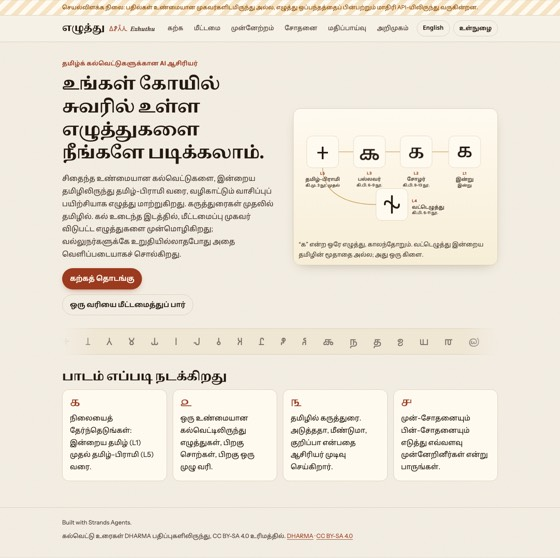 | 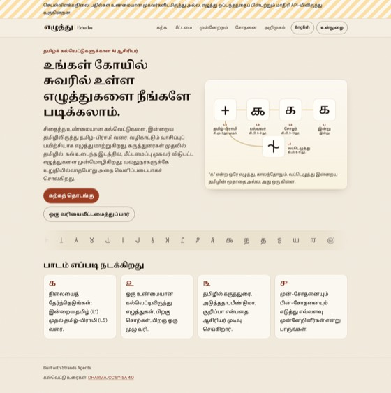 |
| Lesson with a hint (mobile, Tamil) | 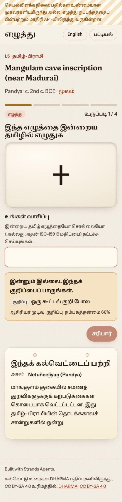 | 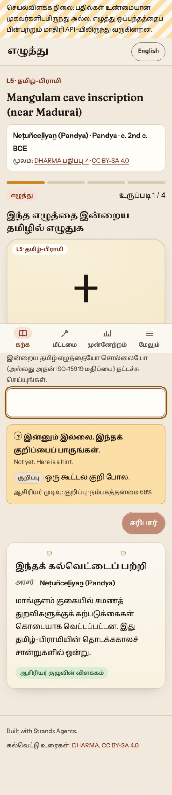 |
| Restore (desktop, Tamil) | 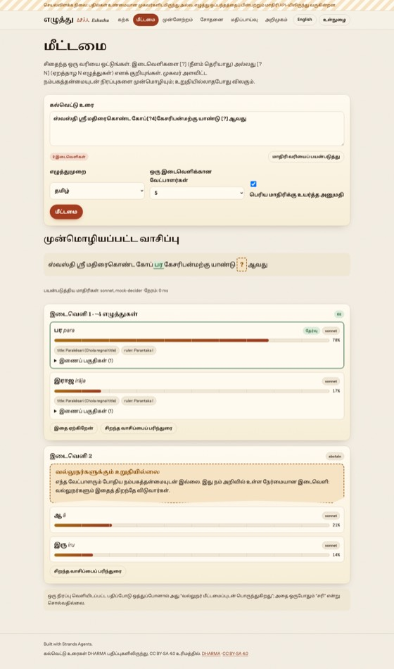 | 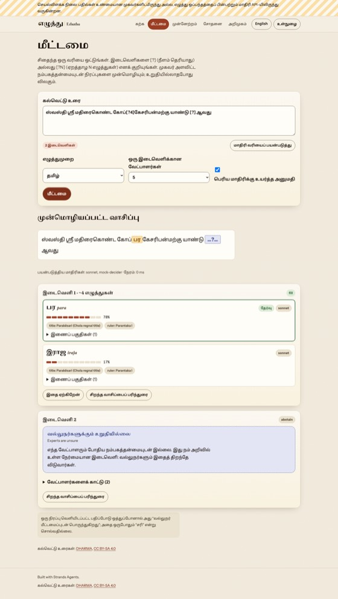 |
| Restore (mobile, Tamil) | 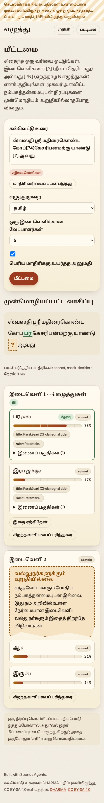 | 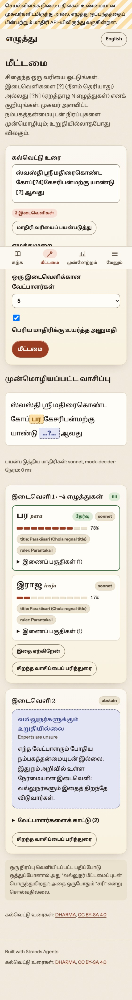 |
| Review queue (mobile) | 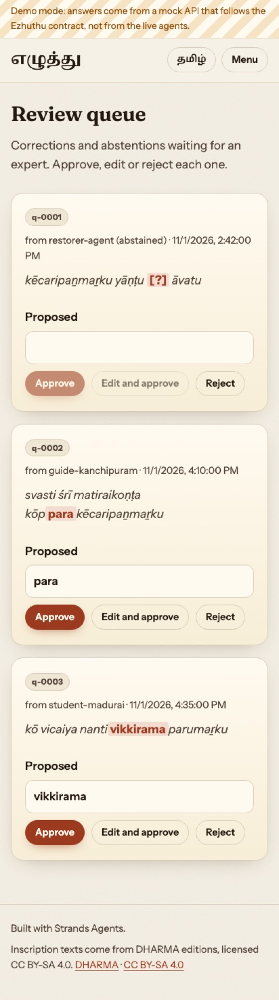 | 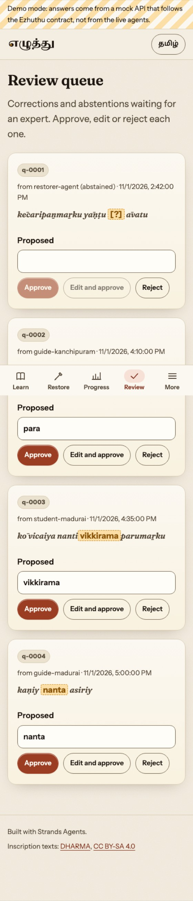 |
| About (mobile) | 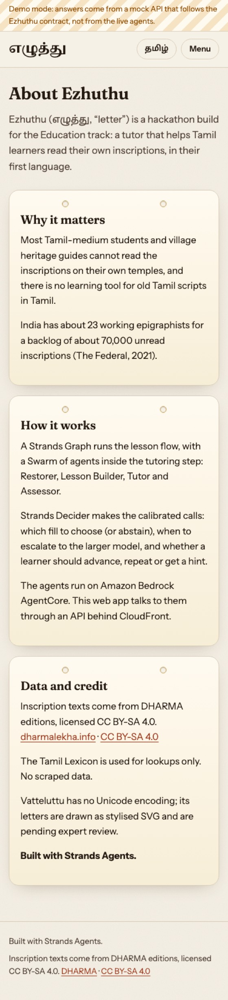 | 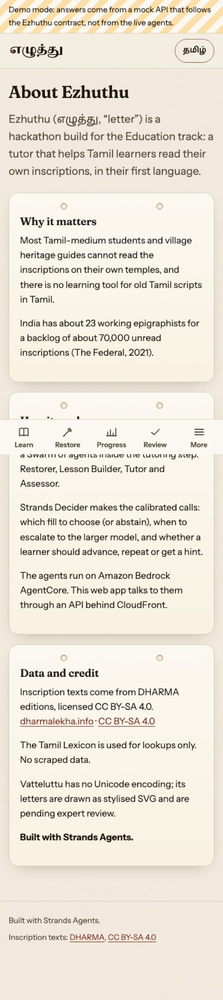 |

New states (after only):

| Decided by rules + tutor-team explanation | 409 on a second review | Dark mode home | Dark mode restore |
| --- | --- | --- | --- |
| 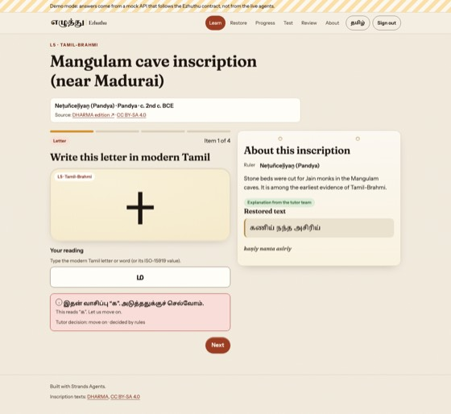 | 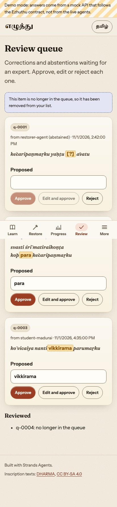 | 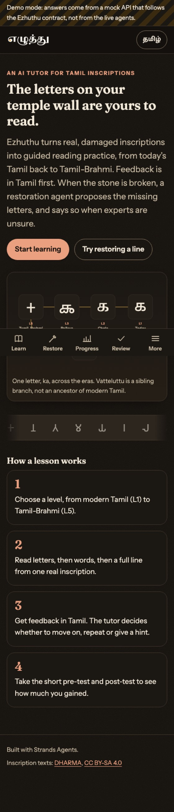 | 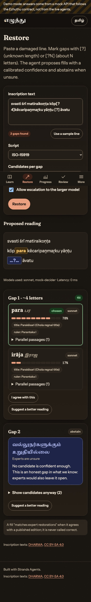 |
