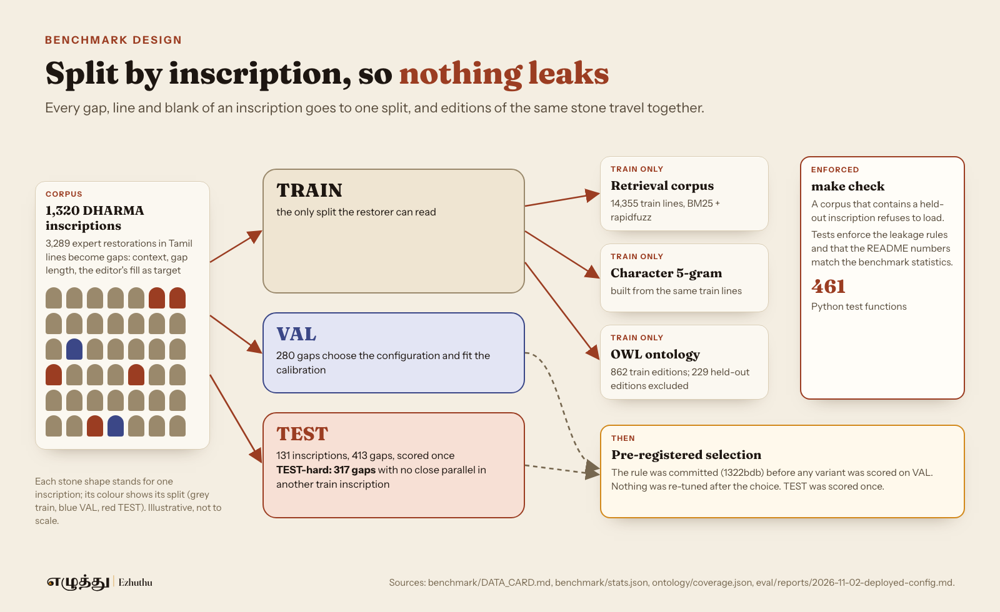
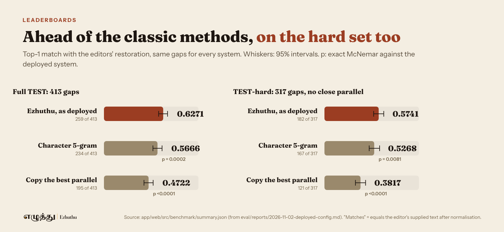

By Vivek Raja, AWS AI Hero

Part 1 introduced Ezhuthu, an apprentice for reading the Tamil inscriptions on the temple walls of Tamil Nadu. Part 2 opened its agent pipeline on Amazon Bedrock AgentCore. This part is about two pieces of work that do not show on the home page: the Strands decision models I fine-tuned for Tamil, and the evaluation discipline behind every number in this series.

Up front, so nobody has to dig for it: the fine-tuned 2B Strands decision model is tested on held-out inscriptions and public on Hugging Face at https://huggingface.co/sparrow-decider/ezhuthu-sparrow-decider-2b, and it is not yet live in the app. The hosted Strands Decider service serves it, and the main branch routes restoration through it with the decider-free pre-rank as the fallback; the live app switches to it at its next deploy. Until then the live app's Restorer runs without it, and everything below says which system each number belongs to.

*The work behind the fine-tuned Strands decision model, in the order it happened.*

## The benchmark: expert restorations, split by inscription

The benchmark comes from 1,320 DHARMA inscriptions and the 3,289 restorations their editors supplied in the Tamil lines. Each restoration becomes a gap: the context on both sides, the gap length, and the editor's fill as the target.

The split is by inscription. Every gap, line and blank of an inscription lands in one split, and editions of the same stone always travel together, so no context or target from a held-out inscription can appear in anything the Restorer reads. The retrieval corpus, the 5-gram model and the ontology are all built from train only, and a corpus that contains a held-out inscription refuses to load. Tests in make check enforce these rules.

The held-out test set is 413 gaps from 131 inscriptions. Tamil inscriptions repeat their formulas, so I also report a hard subset: a gap is hard when no other train inscription contains its target in a similar context. 317 of the 413 test gaps are hard. Reporting it beside the full set keeps a system that only copies parallels from passing as a restorer.

*Leakage is closed by construction and enforced by tests.*

## Choosing the deployed pipeline on validation, then scoring test once

I wrote the selection rule for the deployed configuration and committed it (commit 1322bdb) before any variant was scored. It compares variants by top-1 matches on the same 280 validation gaps, breaks ties toward the cheaper and then the faster variant, and lets the hosted Strands Decider take over only if it scores strictly more matches on a smaller hosted set. The rule picked the routed Sonnet 4.6 to Opus 4.6 pipeline with the noisy-OR pre-rank and the 5-gram as its third term. Nothing was re-tuned after the choice.

The validation gaps turned out harder than the test gaps for every system, including the baselines. So I used validation for two jobs only: ranking variants against each other on the same gaps, and fitting the calibration. Its absolute numbers say nothing about test.

With the configuration and calibration fixed, I scored the test set once. Every comparison below is on the same 413 gaps, with an exact McNemar test on the gaps where only one of the two systems matches.

| System on held-out test | Top-1 match | Only deployed vs only other | p |
|---|---|---|---|
| Ezhuthu as deployed | 0.6271 (259 of 413, CI 0.5787 to 0.6731) | | |
| Character 5-gram model | 0.5666 | 34 vs 9 | 0.0002 |
| Earlier pipeline, routed with a local 2B decider | 0.4964 | 74 vs 20 | < 0.0001 |
| Copy the best parallel passage | 0.4722 | 88 vs 24 | < 0.0001 |

On the hard set it matches 182 of 317 gaps (0.5741), against 0.5268 for the 5-gram (p = 0.0081) and 0.3817 for copying a parallel.

*Same systems, same gaps, full set and hard set.*

By gap length, the wins come from short gaps: 0.7367 on one-letter gaps (n = 281), 0.5185 on two to three letters (n = 81) and 0.1961 on four or more (n = 51). On the 51 test gaps from the Pallava and Uttiramerur age set it reaches 0.5686, and 88.2% of the fills it commits there match.

## Calibration and abstention

A restoration assistant for scholars has to know when to stay quiet. The deployed Restorer calibrates its final score with Platt scaling fitted on validation only (n = 224 for the Opus key, 278 for the Sonnet key) and abstains below the fitted thresholds.

At those thresholds, on held-out test, it fills 49.9% of gaps (206), and 90.8% of those fills match the editors' restoration (187 of 206). The 95 gaps it scores between 0.9 and 1.0 match 97.9% of the time, and the expected calibration error is 0.110. The hard set holds up too, with coverage 0.4101 and 0.9077 of fills matching.

*When it commits, it matches the editors nine times in ten.*

## The fine-tuned Strands decision model

The last step of the Restorer is a choice: given its top 3 candidate fills, pick the one the editors wrote, or none of them. The hosted general-purpose Strands Decider was tested for that step under the rule above and did not earn its place. So I trained one for this exact decision, on Tamil.

### The data, from train only

Training rows have the same shape as the requests the Restorer sends. The label is the option whose fill equals the editor's restoration, or "none". I built them from 2,337 train items: 2,334 choice rows and 6,936 yes-or-no rows. Building the candidates took 1,162 live Sonnet 4.6 calls under a hard cap of 1,200, about USD 4.8.

### Cross-fitting, so the model never sees its own answer key

If a train item's candidates come from a retrieval index that contains the item itself, the right answer leaks into the candidates and the model learns to trust a signal it will never get at test time. So I cross-fitted: the train items are split into 5 folds by stone, and each item's candidates are built with retrieval and the 5-gram from the other folds only. An audit found 0 of 6,996 train parallels coming from the item's own fold.

### Near-duplicates scrubbed

Formulas repeat across stones, so a train item can be a near-copy of a test item. I dropped 96 of 2,433 train items as near-duplicates: 78 matched a test item and 18 a validation item. My first rule, a plain edit distance on the context window, missed formulas gapped at different points, so I added a shift-invariant rule, and it caught the 96. An audit in the reverse direction found 1 shared target among the 413 test items, so at most one test item is affected.

### Three model sizes

I trained three sizes. The chosen one, ezhuthu-strands-2b-ft, continues from Strands Decider v1-2610 2B with a LoRA adapter at rank 48 (50.5M parameters) and a pointer head (3.2M), for 1 epoch of 580 steps of 16 rows. It took 74 minutes per variant on one A100 40 GB, and USD 2.26 for the whole run. The two smaller ones came from the Sparrow line: Sparrow tiny (Ettin-32M, 21 minutes on an Apple M4 Pro) and Sparrow nano (a static model with a Tamil WordPiece vocabulary of 8k, trained in seconds). The 2B model won the selection.

### Pre-registered, chosen on validation, test scored once

I committed the selection rule (commit 2c2f5b2) before the validation runs. Eight decider variants were compared on the same 280 validation gaps. Calibration was fitted on validation only (n = 443 and 244). The test run replayed cached candidates and made 0 new Bedrock calls, and I scored it once.

## What the fine-tuned model does on held-out test

Inside the Restorer, ranking the same Sonnet 4.6 candidates on all 413 test gaps:

| Ranking of the same candidates | Top-1 match on test | Only fine-tuned vs only other | p |
|---|---|---|---|
| Fine-tuned 2B Strands decision model | 0.6538 (270 of 413, CI 0.6077 to 0.6973) | | |
| Deployed noisy-OR pre-rank | 0.5908 | 32 vs 6 | 2.4e-5 |
| Base Strands Decider 2B | 0.5811 | 41 vs 11 | 3.6e-5 |

It also knows when it knows. At its validation thresholds it fills 57.6% of test gaps, and 92.0% of its 238 fills match the editors' restoration, with an expected calibration error of 0.070. On the hard subset it reaches 0.5962.

Judged as a pure decision model, on the 413 recorded test requests, it picks the editors' fill 0.5472 of the time against a ceiling of 0.6029, the share of gaps where the target is among the 3 options at all. That is 90.8% of the gaps it can reach. The hosted general-purpose Strands Decider (v19) gets 0.4310 on the same requests and the base 2B gets 0.4165, so fine-tuning for Tamil adds 11.6 points over the hosted decider, with p < 1e-8. Its yes-or-no head reaches an AUC of 0.971 with an expected calibration error of 0.015. The decider itself takes 0.83 s per gap at p50 on an Apple M4 Pro, and the checkpoint is 224 MB.

*Fine-tuned for Tamil, tested on held-out inscriptions, public on Hugging Face, not yet live in the app.*

One caution on reading these numbers. The deployed system's 0.6271 comes from routed candidates, with Opus on 296 gaps. The fine-tuned model's 0.6538 comes from Sonnet-only candidates replayed from a cache, because routing it on test would have needed new Opus calls that the pre-registered protocol did not allow. The two runs are not a paired comparison, and the fine-tuned model's routed test number is unknown.

## What did not work

Long gaps. On gaps of four or more letters (n = 51) the deployed system matches 19.6%, the same as copying a parallel.

The fine-tuned model on the frozen benchmark. On the frozen 60-item hard benchmark, built in an older request format the model was never trained on, it ties the LLM's own confidence score at 0.400 and sits below the hosted v19 decider at 0.450 (p = 0.375). It is only 60 items and the gap is not significant, and I report it anyway.

Ontology hints for restoration. Hints made no measurable difference: on 88 hinted gaps, 3 gained and 3 lost, and the hint hit@5 on held-out test was 16 of 253. The ontology stays for teaching, where the Tutor uses it for history and hints.

Photo reading of the older scripts. On 3 real Tamil-Brahmi images the character error rate is 0.83 to 0.91, Grantha is 0.56 on synthetic plates, Vatteluttu is unmeasured, and no real stone photo has been scored against an edition yet. Ezhuthu reads Tamil-script photos and teaches the older letters in Practice.

My first calibration fit. The undamped Newton step in the Platt fit diverged on the chosen variant's scores. I found it after the validation runs and before the calibration was written, switched to a step that halves when a full step does not lower the loss, and the choice itself was unaffected.

Two risks stay open. A match with the editors' restoration is agreement with expert judgement, which is no proof of the original text. And a hosted LLM may have seen DHARMA or South Indian Inscriptions texts in pretraining, which I cannot rule out.

## What is next

Serving is done: the hosted Strands Decider service serves the fine-tuned Strands decision model, and the main branch ranks with it inside the 25-second budget. The next job is the deploy that puts it in the live app, then faster serving for the decider call, which runs on CPU today. After that come a near-duplicate scrub in both directions for the next training build, a stronger approach to long gaps, an expert study, and the learner pilot with student volunteers from the AWS User Group Madurai.

Everything in this series is reproducible from the reports in eval/reports at https://github.com/Vivek0712/ezhuthu, and the system is live at https://d3jz2k92ne5puo.cloudfront.net. The end-to-end Jupyter notebook walks through the data, the ontology over MCP, retrieval and the 5-gram, the Strands restorer on Amazon Bedrock with the fine-tuned decider served from Hugging Face, the Graph and Swarm lesson, the live AgentCore API and the test evaluation: https://github.com/Vivek0712/ezhuthu/blob/main/notebooks/ezhuthu_end_to_end.ipynb.

## Credits

Inscription texts: the DHARMA project (ERC grant 809994) and the named editors of each edition, CC BY-SA 4.0. The derived benchmark is shared under CC BY-SA 4.0.

Hero photograph on the live site: "Brihadishwara Temple, Dedicated to Shiva, built by Rajaraja I, completed in 1010, Thanjavur (38)" by Richard Mortel, CC BY 2.0 (https://creativecommons.org/licenses/by/2.0/), via Wikimedia Commons (https://commons.wikimedia.org/wiki/File:1010_CE_Brihadishwara_Shiva_Temple,_inscription,_built_by_Rajaraja_I,_Thanjavur_Tamil_Nadu_India.jpg); cropped and resized.

Fonts: Noto Serif Tamil, Noto Sans Tamil, Noto Sans Brahmi, Noto Sans Grantha, Fraunces and Instrument Sans, SIL OFL 1.1.

Built with Strands Agents and Strands Decider; runs on Amazon Bedrock AgentCore; models Claude Sonnet 4.6 and Claude Opus 4.6 on Amazon Bedrock.
