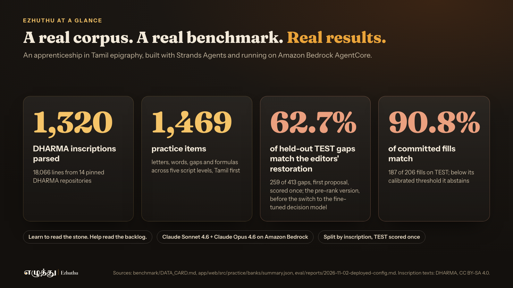
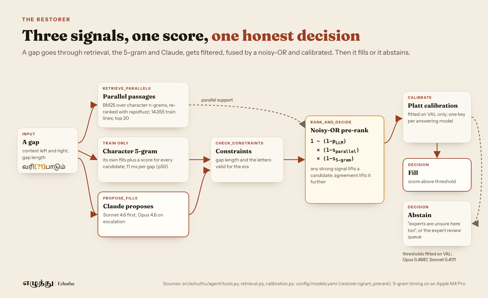

By Vivek Raja, AWS AI Hero

The great temple at Thanjavur has stood for over 1,000 years, and its walls are written in Tamil. Rajaraja I Chola completed it in 1010 CE. Tamil is one of the oldest living languages in the world, and across Tamil Nadu, from Madurai to Thanjavur, temple walls hold more than a thousand years of its writing. Time, weather and repairs are wearing the letters away.

In 2021 India had about 23 epigraphists. Of nearly 1 lakh (100,000) inscriptions found since 1886, only 30,000 to 35,000 had been deciphered and published (The Federal, 3 August 2021). Training a new reader is slow and depends on a mentor, and most learners cannot read the inscription on their own village temple. There was no tool that teaches old Tamil scripts in Tamil.

So I built Ezhuthu. The name is the Tamil word for "letter". It is an apprenticeship tool for Tamil epigraphy, submitted to the Education track. It teaches students, heritage guides and new epigraphists to read real, damaged inscriptions, Tamil first. It gives scholars an assistant that proposes the worn-away letters, shows how sure it is, and hands its doubts to an expert.

- Live app: https://d3jz2k92ne5puo.cloudfront.net
- Code (Apache-2.0): https://github.com/Vivek0712/ezhuthu
- Fine-tuned decision model: https://huggingface.co/sparrow-decider/ezhuthu-sparrow-decider-2b
- End-to-end Jupyter notebook (data, ontology over MCP, Strands agents on Amazon Bedrock, the fine-tuned decider, the live AgentCore API and the evaluation): https://github.com/Vivek0712/ezhuthu/blob/main/notebooks/ezhuthu_end_to_end.ipynb

*Ezhuthu at a glance. Every number traces to an evaluation report in the repository.*

## The problem: damage is the normal case

Ezhuthu works from 1,320 published editions by the DHARMA project (CC BY-SA 4.0), parsed from TEI/EpiDoc into 18,066 lines. 858 of those 1,320 inscriptions (65%) have a restored passage or a gap. The editors restored 3,289 spans in Tamil lines, and 3,557 more gaps of known size have no restoration at all. 410 of the restorations sit in Pallava inscriptions over 1,100 years old.

A reading tutor for these texts has to handle damage honestly. It cannot pretend every letter is known, and it cannot present a guess as settled. That shaped every design choice below.

## What Ezhuthu does

- **Practice.** 1,469 drills built from real stones: letters, words, formulas and gaps, each at three difficulty levels, with hints and history in Tamil and English optional. A pre-test and post-test report a learner's gain in letters read and time per letter.
- **Five reading levels.** The same text moves from modern Tamil back through Chola Tamil, Pallava (Grantha), Vatteluttu and Tamil-Brahmi. Vatteluttu has no Unicode encoding, so I drew its teaching glyphs.
- **Restore.** Paste a damaged line. The Restorer proposes fills with parallel passages from other inscriptions, fills only when its calibrated confidence clears a threshold, and otherwise leaves the gap open for an expert. When there is a published edition, the app shows whether the fill matches the editors' restoration.
- **Reader and Interpreter.** A photo or EpiDoc file becomes an editable transcription, then words, a phrase in today's Tamil and a plain meaning.
- **Expert review.** Experts sign in (Amazon Cognito, `experts` group) to review what the assistant left open.

When the Restorer is unsure, the lesson says so: experts are unsure here too. Doubt becomes part of what the learner is taught.

*One letter hidden on purpose. The Restorer fills it at 72%, and the published edition reads the same letter.*

## How I built it: agents, an ontology and a decision model

*The whole system on one page: five CDK stacks, one AgentCore runtime, two Claude models.*

Every agent is built with Strands Agents and runs on Amazon Bedrock AgentCore Runtime, with Claude Sonnet 4.6 and Claude Opus 4.6 on Amazon Bedrock.

- **A Graph for every lesson, a Swarm for the teaching.** A Strands Graph runs `restore`, then `lesson_builder`, then a Swarm in which a Tutor and an Assessor work together. A Strands Decider makes the tutor's advance, repeat or hint call, with rule guardrails.
- **The Restorer is a tool-using agent.** It has five Strands tools: `retrieve_parallels` (BM25 over character n-grams across 14,355 train lines, re-ranked with rapidfuzz), `propose_fills`, `check_constraints`, `rank_and_decide` and `ontology_hints`.
- **Routing between models.** Sonnet 4.6 answers first. A gap goes to Opus 4.6 when Sonnet's best score is under 0.6, the gap is longer than 12 letters, or there is no good parallel.
- **Three signals, one calibrated score.** Candidates are pre-ranked by a noisy-OR of the LLM's probability, parallel-passage support and a character 5-gram's share. The top score is Platt-calibrated on the validation split to decide fill or abstain.
- **A custom Tamil epigraphy ontology over MCP.** An OWL ontology with 27 classes, 21 object properties and 1,958 named individuals: 42 rulers, 357 places, 139 temples, 14 formulas and 8 taxes, with dynasties and rulers linked to Wikidata. I built it from train editions only and serve it to the agents through my own MCP server. It supplies the history in every lesson.
- **A 25-second request budget.** The API proxy allows 27 seconds per request, so the Restorer handles at most 8 gaps per request, skips the Opus escalation or the LLM call when time runs short, and returns an `abstain_reason` for any gap it could not reach. Three requests that timed out at 30.8 s, 49.6 s and 58.4 s now answer in 20.9 s, 25.0 s and 25.0 s.
- **All as code.** Five AWS CDK stacks in TypeScript: DynamoDB (on demand, point-in-time recovery), Cognito, the AgentCore Runtime, API Gateway with a JWT authorizer and a Lambda proxy, and a private S3 bucket behind CloudFront. Model IDs live in one config file, and the decider key lives only in AWS Secrets Manager.

*From a gap to a decision in one pass.*

## A Strands decision model fine-tuned for Tamil

The last step of a restoration is a decision: of the top three candidate fills, which one matches the editors, or none. I fine-tuned the 2B Strands Decider for exactly that decision.

- **Data from TRAIN only.** 2,334 choice rows and 6,936 yes/no rows, built from the Restorer's real requests. Train candidates were cross-fitted over 5 folds by stone, so no item saw its own answer key, and 96 formulaic near-duplicates of held-out lines were dropped.
- **Cheap to train.** One epoch on one A100 40 GB GPU, 74 minutes, about USD 2.26 of compute.
- **Chosen on validation, tested once.** I committed the selection rule before scoring any variant, compared 8 variants on 280 validation gaps, and scored the held-out TEST split once.
- **Results on 413 held-out TEST gaps.** Ranking the same Sonnet 4.6 candidates, the Restorer with the fine-tuned decider matches the editors' restoration on 65.4% (270 of 413), against 59.1% for the decider-free pre-rank. As a decision model on its own, it picks the editors' fill on 54.7% of requests, against 43.1% for the general hosted Strands Decider (p < 1e-8). On an older 60-item benchmark in a request format it was not trained on, it does not win.

The weights are public on Hugging Face as `sparrow-decider/ezhuthu-sparrow-decider-2b`, with the model card, an example request and checksums. The hosted Strands Decider service serves it next to the general model on the same instances, and the main branch now routes restoration through it, with the pre-rank as the fallback.

*Fine-tuned for Tamil and tested once on held-out inscriptions. The 90.8% in the dark panel is the share of reachable gaps the decider gets right, a different measure from the 90.8% of committed fills at the top of this article.*

## Results, scored once on held-out data

The configuration the live app runs was chosen on the validation split by a rule committed before any variant was scored, calibrated on validation, and scored once on 413 held-out TEST gaps. A match means the fill equals the DHARMA editor's supplied text after normalisation. Editors' restorations are expert judgement, so this is agreement with the edition, not a claim about what the stone said.

- **62.7% of held-out gaps match the editors' restoration** (259 of 413, 95% CI 57.9 to 67.3).
- **When it commits, 9 in 10 match.** At its validation-fitted threshold it fills 49.9% of gaps, and 90.8% of those fills match (187 of 206). The rest go to an expert.
- **It beats the existing methods on the same gaps.** A character 5-gram language model gets 0.5666 top-1 (34 vs 9 discordant gaps, p = 0.0002). Copying the best parallel passage, the epigrapher's classic move, gets 47.2% (p < 0.0001).
- **Single letters: about three in four** (73.7% of 281 one-letter gaps). Long gaps stay hard: 19.6% on gaps of 4 or more letters.
- **Fast and cheap.** Per gap, p50 3.2 s and p90 5.5 s, about USD 0.006 at list prices.

*Same systems, same gaps, on the full test set and on the hard set.*

## Honest limits

- The Reader cannot read Tamil-Brahmi photos yet (character error rate 0.83 to 0.91 on real photos), so that level teaches from edition text and drawn letters.
- The ontology hints made no measurable difference to restoration accuracy. The ontology earns its place in the lessons and the history.
- Learner gain is not measured yet. The pre-test and post-test are built, and a pilot with AWS UG Madurai student volunteers is next.
- The Tamil strings are pending a native-speaker review, and the drawn Vatteluttu glyphs are pending an epigrapher's review.

## Who it helps

- **Students and heritage guides** get guided practice on real stones, in Tamil, at five levels.
- **New epigraphists** get damaged texts to practise on, with an assistant that shows its doubts instead of hiding them.
- **Working scholars** get an assistant that fills what it is confident about and routes the rest to the review queue.

Everything is open: the code under Apache-2.0, the restoration benchmark under CC BY-SA 4.0, the fine-tuned decision model on Hugging Face, and every number in this article in an evaluation report in the repository. Ezhuthu does not replace an epigraphist. It helps more people learn to read the stones while the people who can teach them are still here.

Thanks to the DHARMA project and the editors of every edition used here, whose restorations are the benchmark, and to the Strands Agents and Strands Decider teams.

## Credits

Inscription texts: the DHARMA project (ERC grant 809994) and the named editors of each edition, CC BY-SA 4.0. The derived benchmark is shared under CC BY-SA 4.0.

Cover photograph: "Brihadishwara Temple, Dedicated to Shiva, built by Rajaraja I, completed in 1010, Thanjavur (38)" by Richard Mortel, CC BY 2.0 (https://creativecommons.org/licenses/by/2.0/), via Wikimedia Commons (https://commons.wikimedia.org/wiki/File:1010_CE_Brihadishwara_Shiva_Temple,_inscription,_built_by_Rajaraja_I,_Thanjavur_Tamil_Nadu_India.jpg); cropped, letter outlines added.
