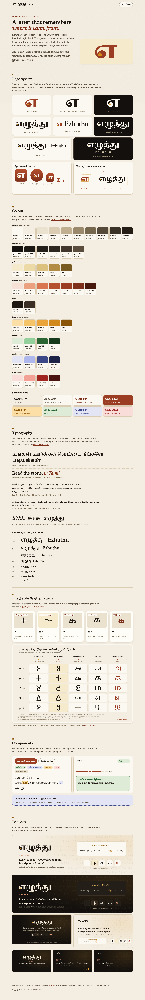

# design/: Ezhuthu brand and design system

Owner: Design & Brand (KrewHQ `u:design`), issue #8. Open **[`preview.html`](preview.html)** in any browser (no build step) for the living style guide.

<picture>
  <source media="(prefers-color-scheme: dark)" srcset="renders/preview-dark.png">
  
</picture>

## What is here

| Path | Contents |
| --- | --- |
| [`brand/BRAND.md`](brand/BRAND.md) | Idea, name usage, Tamil/English voice, do/don't, logo rules, clear space, minimum sizes |
| [`brand/FONTS.md`](brand/FONTS.md) | Typefaces, licences (all SIL OFL 1.1), pairings, type scale, Tamil line heights, fallbacks |
| `brand/logo/` | Mark, Tamil, Latin and bilingual wordmarks/lockups in colour, mono, reversed and reversed-mono (pure-path SVG), plus PNGs in `logo/png/` |
| `brand/icons/` | `favicon.svg`, `favicon-16/32.png`, `apple-touch-icon-180.png`, `icon-192/512.png`, `icon-maskable-192/512.png`, `og-image.png` (1200 × 630) |
| `brand/banners/` | README hero (1280 × 400, light/dark), social preview (1280 × 640), video cards (1920 × 1080), Builder Center header (1600 × 900) |
| [`tokens/tokens.json`](tokens/tokens.json) | The source of truth for colour, spacing, radii, shadows, motion and type |
| `tokens/tokens.css` · `tokens/app-compat.css` · `tokens/tailwind-preset.js` | Generated CSS variables, a bridge onto the app's current variable names, and an optional Tailwind preset |
| [`tokens/CONTRAST.md`](tokens/CONTRAST.md) | WCAG contrast results for every text and UI pair, light and dark (70/70 pass, plus a list of restricted pairs) |
| `glyphs/` | Vatteluttu SVGs and `vatteluttu.json`, the evolution strip, the glyph-card reference; [`REFERENCES.md`](glyphs/REFERENCES.md) and [`GLYPH-CARD.md`](glyphs/GLYPH-CARD.md) |
| [`ux/UX.md`](ux/UX.md) · `ux/wireframes/` | UX spec (IA, flows, components, states, bilingual rules, a11y) and mobile wireframes |
| `renders/` | PNG renders of the style guide, the evolution strip, the construction sheet and the wireframes |
| `tools/` | Build and render scripts (below) |

## For the app team: adopting the system (wave 2)

1. **Tokens.** Import `design/tokens/tokens.css` once (copy it to `app/web/src/styles/tokens.css`, or import it from the repo root through Vite's `server.fs.allow`). Then import `design/tokens/app-compat.css`, which maps the app's existing names (`--bg`, `--surface`, `--ink`, `--accent`, `--gold`, `--warn`, …) onto the tokens. Delete the three `:root` colour blocks at the top of `app/web/src/styles/app.css`. Nothing else has to change on day one. Over time, move components to the `--ez-*` names.
   - The new semantic `--ez-unsure` / `--ez-unsure-soft` (indigo) is for **abstain**. The app currently uses `warn` (amber) for it. Please switch, so that "experts are unsure" reads as calm rather than as a warning.
   - Dark mode works the same way the app's does: `prefers-color-scheme`, overridden by `[data-theme]`.
2. **Logo and header.** Replace the text brand (`.brand-ta` / `.brand-brahmi` / `.brand-en`) with `design/brand/logo/lockup-horizontal-color.svg` (and `-reversed` in dark mode), at a height of 32–36 px. Below 560 px, use `wordmark-ta-color.svg` alone.
3. **Icons.** Copy `design/brand/icons/favicon.svg` over `app/web/public/favicon.svg`, and add these to `index.html` and the PWA manifest:
   ```html
   <link rel="icon" type="image/svg+xml" href="/favicon.svg">
   <link rel="icon" type="image/png" sizes="32x32" href="/favicon-32.png">
   <link rel="apple-touch-icon" href="/apple-touch-icon-180.png">
   <meta property="og:image" content="/og-image.png">
   ```
   Manifest: `icon-192.png`, `icon-512.png` (`purpose: any`) and `icon-maskable-192/512.png` (`purpose: maskable`), with `theme_color` `#F4EEE2` and `background_color` `#F4EEE2`.
4. **Vatteluttu.** `design/glyphs/vatteluttu.json` holds drawn glyphs keyed by ISO-15919 (`a, ka, ma, e, ḻa, ta, pa`), to resolve the API's `glyph_svg: "vatteluttu:<iso>"`. It supersedes `app/web/src/lib/vatteluttu.ts` for `ka, ta, pa, ma` and adds `a, e, ḻa`. Keep the app's `ṉa` until it is reviewed. Stroke them with `currentColor`, width 8 on the 100-unit grid.
5. **Screens.** Follow [`ux/UX.md`](ux/UX.md): bottom tabs below 1000 px, the abstain card, the banded confidence meter (% only in expert mode), and the DHARMA source line on every lesson.
6. **Screenshots.** Keep writing them to `app/web/screenshots/`. The README links there.

## Rebuilding

Everything is generated from scripts, so the results are reproducible.

```bash
# Python 3.9+ (any venv). These deps are design-only: they are not added to pyproject.toml.
python3 -m venv /tmp/ez-design && /tmp/ez-design/bin/pip install -r design/tools/requirements.txt
/tmp/ez-design/bin/python design/tools/fetch_fonts.py        # OFL fonts -> ~/.cache/ezhuthu-design-fonts
python3 design/tools/build_tokens.py                         # tokens.css, app-compat.css, tailwind-preset.js, CONTRAST.md
cd design/tools && /tmp/ez-design/bin/python build_logos.py && /tmp/ez-design/bin/python build_glyphs.py \
  && /tmp/ez-design/bin/python build_banners.py && python3 build_wireframes.py && cd -
cd design/tools && npm install && npx playwright install chromium && node render.mjs && cd -   # all PNGs
python3 design/tools/check_design.py                         # validation (stdlib only)
```

**Render tool (recorded for the acceptance criteria).** PNGs are rasterised with **headless Chromium 141.0.7390.37 through Playwright 1.56.1** (`design/tools/render.mjs`). It opens each SVG, or `preview.html`, sizes it to the job in `tools/renders.json`, and takes a screenshot. Wireframes and `preview.html` load their fonts from Google Fonts. Logos and banners need no fonts, because their text is outlined to paths with HarfBuzz shaping (`tools/outline.py`), so Tamil conjuncts are shaped correctly.

`check_design.py` checks that every SVG is valid XML with a viewBox, that every render exists at the expected pixel size, that the token files are current and all contrast pairs pass, that the banned brand phrases (listed in `BANNED` in the script) are absent, and that relative links in the docs resolve.
