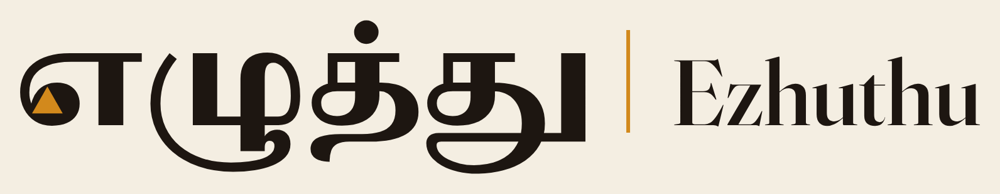
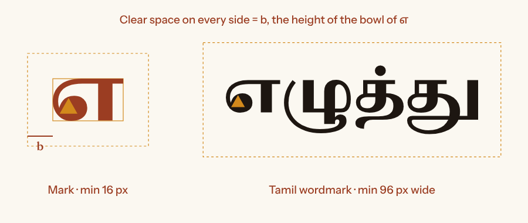

# Ezhuthu brand

## 1. The idea

**எழுத்து** means "letter" and "writing". Every Tamil learner already reads the modern letter **எ** (e). Its oldest ancestor is the Tamil-Brahmi **e**, a plain triangle (U+1100F 𑀏), cut into cave beds near Madurai about 2,000 years ago.

The mark puts the ancestor inside the descendant: the bowl of எ holds a triangle. The idea behind the product is the same: what you can read today is a way into what is cut in stone. The triangle is in the temple-lamp colour because the lamp is what lets you read a dark temple wall.

## 2. Name usage

| Context | Write | Notes |
| --- | --- | --- |
| Tamil text | **எழுத்து** | Always in Tamil script in Tamil copy. |
| English text, first mention | **Ezhuthu (எழுத்து)** | After that, just Ezhuthu. |
| Bilingual titles | **எழுத்து · Ezhuthu** | Tamil first, separated by a middle dot ( · ) with spaces. |
| Pronunciation | *e-zhu-thu*, where "zh" is the Tamil ழ (ḻa) | ISO-15919: *eḻuttu*. |

Never write: EZHUTHU AI, Ezhuthu.ai, Ezuthu, Ezhutthu, E-zhuthu. All caps (EZHUTHU) is only used as a tracked sub-label in the stacked lockup and on video kickers.

## 3. Voice

Ezhuthu sounds like a patient teacher at a temple: warm, exact and never grand. Since positioning C
([docs/marketing/positioning.md](../../docs/marketing/positioning.md)) it speaks to two audiences in two registers of
the same voice:

- **To students and new epigraphists: a teacher.** Encouraging, specific, Tamil first, as below.
- **To working scholars: a mentor briefing an apprentice's work.** Matter-of-fact and evidence-first: say what was
  read, with what confidence, from which parallels, and what was left for an expert. Never grand, never salesy, and
  never ahead of the numbers. "It abstained on 3 gaps and sent them to review" beats "AI-powered restoration".

Tagline: *Learn to read the stone. Help read the backlog.* /
*கல்வெட்டைப் படிக்கக் கற்றுக்கொள்ளுங்கள்; காத்திருக்கும் கல்வெட்டுகளைப் படிக்க உதவுங்கள்.* (the Tamil line is pending
a native-speaker check). Product names: Practice (பயிற்சி), Restore (மீட்டமை), Benchmark (அளவுகோல்), Expert review
(வல்லுநர் மதிப்பாய்வு), Progress (முன்னேற்றம்).

| | Tamil | English |
| --- | --- | --- |
| Register | Plain modern Tamil (பேச்சுக்கு நெருக்கமான எழுத்துத் தமிழ்). No Sanskrit-heavy or archaic words unless we are teaching them. | Plain English, short sentences. |
| Addressing the learner | நீங்கள் (respectful), not நீ. | "you". |
| Praise | Specific: "குறுக்குக் கோடு வளைந்து க ஆனது." | "The cross-bar became a wave: that is ka." |
| Uncertainty | "வல்லுநர்களுக்கும் உறுதியில்லை" | "Experts are unsure." |
| Mistakes | Gentle, with a reason and a hint. Never "தவறு!" alone. | Never "Wrong!" alone. |
| Scholar-facing | Evidence first: "நம்பகம் 0.20; மூன்று இடைவெளிகள் வல்லுநர் மதிப்பாய்வுக்கு." | "Confidence 0.20; three gaps sent to expert review." |
| The backlog | "1886 முதல் கண்டெடுக்கப்பட்ட ஏறத்தாழ 1 இலட்சம் கல்வெட்டுகளில் 30,000–35,000 மட்டுமே வெளியிடப்பட்டன." | "About 23 epigraphists; of about 1 lakh inscriptions found since 1886, 30,000 to 35,000 published (The Federal, 2021)." Never "a backlog of 70,000". |

**Never claim** that Ezhuthu clears the backlog, replaces epigraphists or deciphers inscriptions; that it reads
Tamil-Brahmi, Grantha or Vatteluttu from photos; that scholars have validated it; or that L5 lessons come from
Tamil-Brahmi editions. Say "built with Strands Agents", never "Strands AI" or "AWS AI".

**Claims.** A restoration "matches expert restorations" (வல்லுநர் மீட்டமைப்புடன் பொருந்துகிறது). It is never "correct" or "true". "Over 1,100 years old" applies only to the Pallava collection (410 restorations); never say it of the Uttiramerur items or of the whole age set. Every number in the README, video or app comes from `eval/reports/` or `benchmark/DATA_CARD.md`; if a number is not there yet, write **TBD**.

## 4. Do and don't

**Do**

- Say **"built with Strands Agents"**. That is the only "built with" credit; do not claim tools that were not used in the shipped build.
- Name **Amazon Bedrock AgentCore** in full on first mention.
- Credit **DHARMA** wherever inscription text appears: "Inscription texts: DHARMA, CC BY-SA 4.0", with a link to the edition when one is shown.
- Put Tamil first in titles, buttons and feedback.
- Use the mark at 16 px or larger and the Tamil wordmark at 96 px wide or larger.
- Use the colour mark on stone or palm backgrounds and the reversed mark on granite or laterite.

**Don't**

- Never write "Strands AI", "AWS AI", or "Amazon AI".
- Don't redraw, rotate, outline, add shadows to or animate the mark's shape. You may fade it in.
- Don't place the colour mark on laterite. Use reversed or a tile instead.
- Don't recolour the triangle in anything other than lamp (`lamp-500` on light, `lamp-400` on dark) or a knockout.
- Don't set the wordmark in a live font. Use the SVG files.
- Don't present drawn Vatteluttu glyphs as facsimiles of a dated inscription (see `../glyphs/REFERENCES.md`).
- No stock "AI" imagery: no circuit brains, glowing robots or sparkles.

## 5. Logo system

All files are in `design/brand/logo/` and are pure vector paths (no fonts needed). PNG exports are in `logo/png/`.

| Asset | Files | Use |
| --- | --- | --- |
| Mark | `mark-color.svg`, `mark-ink.svg`, `mark-mono.svg`, `mark-reversed.svg`, `mark-reversed-mono.svg` | Avatars, favicons, small spaces. |
| Tamil wordmark | `wordmark-ta-{color,mono,reversed,reversed-mono}.svg` | The default logo in Tamil contexts and the app header. |
| Latin wordmark | `wordmark-en-{color,mono,reversed,reversed-mono}.svg` | English-only contexts (slides for non-Tamil audiences). |
| Horizontal lockup | `lockup-horizontal-{color,mono,reversed,reversed-mono}.svg` | README, website header, footers. |
| Stacked lockup | `lockup-stacked-{color,mono,reversed,reversed-mono}.svg` | Title cards, posters, square spaces. |
| Icons | `../icons/favicon.svg`, `favicon-16/32.png`, `apple-touch-icon-180.png`, `icon-192/512.png`, `icon-maskable-192/512.png`, `og-image.png` | Web app and PWA manifest. |

"Mono" knocks the triangle out of the letter, so the shape still works in one colour (stamps, embossing, single-colour print).

### Construction

- **b** = the height of the bowl of எ in the artwork. Keep at least **b** clear on every side of the mark and of any wordmark or lockup.
- Minimum size: **mark 16 px**, **Tamil wordmark 96 px wide**, **horizontal lockup 160 px wide**. In print: mark 5 mm, wordmark 20 mm.
- **Small-size variant.** Below these sizes the Brahmi triangle shrinks to a speck, so drop it and use the solid letter:
  - mark **below 24 px** (favicons): use `favicon-16.svg/png`, the solid எ with no triangle;
  - Tamil wordmark **below 240 px wide** (corner marks on video cards, footers): solid எ, no triangle. `build_banners.py` applies this automatically (`SMALL_WORDMARK_W = 240`).
  - At these sizes the solid letter reads as plain எ. Never shrink the colour artwork and hope the triangle survives.
- Source glyph: Noto Serif Tamil, weight 900 for the mark and 800 for the wordmark (SIL OFL 1.1, outlines embedded as paths, which the OFL allows). The bowl's counter is closed and a triangle is cut in, centred on the bowl's optical centre. Its width is 1.36 × the original counter width and its height is 0.88 × its width. These values were tuned by eye from 16 px to 512 px. Build: `design/tools/build_logos.py`.

## 6. Colour, type, motion

Colour: `../tokens/tokens.json` (contrast table in `../tokens/CONTRAST.md`). Type: `FONTS.md`. In short:

- **Stone** for pages, **palm leaf** for teaching panels, **laterite** for the brand and its actions, **ink** for text, **lamp** for focus and the one thing to look at, **neelam (indigo)** for "experts are unsure", **neem** for success, **kumkum** only for errors.
- Motion is calm: 140 to 220 ms with the standard easing. Use "chisel" easing (`--ez-ease-chisel`) for revealing a restored letter. Nothing moves under `prefers-reduced-motion`.

## 7. Banners

| File | Size | Use |
| --- | --- | --- |
| `banners/readme-hero-{light,dark}.svg/.png` | 1280 × 400 | README `<picture>` hero |
| `banners/social-preview.png` (+ `-dark`) | 1280 × 640 | GitHub repo settings, Social preview (the repo owner uploads it) |
| `icons/og-image.png` | 1200 × 630 | `og:image` / `twitter:image` |
| `banners/video/00-title-*.png` … `05-credits.png` | 1920 × 1080 | Hackathon video title and section cards |
| `banners/builder-center-header.png` | 1600 × 900 | AWS Builder Center article header |

The inscription line in the banners (…மதிரைகொண்ட கோப்[பர]கேசரிவர்மற்கு…) is the Parantaka I title formula used as the app's sample. It is illustrative, and the banner labels the fill "proposed", not "correct".
