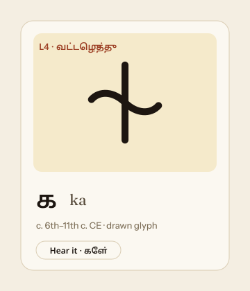

# Glyph card: component spec

A glyph card shows one letter at one era. It appears in Learn (level ladder tiles), Lesson (the question), the pre- and post-tests, and the evolution views.



## Anatomy

```
┌──────────────────────────────┐  card: surface-raised, 1px border, radius-lg (18), shadow-2, padding 12
│ ┌──────────────────────────┐ │
│ │ [L4 · வட்டெழுத்து]        │ │  level chip: 11.5px/700, accent-text on surface, pill, top-left 8px
│ │                          │ │  well: surface-sunk (palm `leaf` for drawn Vatteluttu), radius-md,
│ │           ⺊             │ │        shadow-carved, min-height 132 (lesson: 160+), glyph centred
│ │                          │ │  glyph: font-size `glyph` (4.5rem) or SVG 84px (lesson 96–120px)
│ └──────────────────────────┘ │
│  க  ka                        │  meta: Tamil letter (Noto Sans Tamil 600, 1.6rem) + ISO (Fraunces italic, text-muted)
│  Vatteluttu · c. 6th–11th c.  │  era line: xs, text-faint; append "drawn glyph" for Vatteluttu
└──────────────────────────────┘
```

## Props (React suggestion)

```ts
type GlyphCardProps = {
  level: 'L1' | 'L2' | 'L3' | 'L4' | 'L5';
  iso: string;                 // ISO-15919, e.g. "ka", "ḻa"
  tamil: string;               // modern Tamil letter
  glyphText?: string;          // Unicode glyph for L1/L2/L3/L5 (API: glyph_text)
  glyphSvg?: string;           // "vatteluttu:<iso>" for L4 (API: glyph_svg) -> design/glyphs/vatteluttu.json
  hideAnswer?: boolean;        // lesson/test: hide `tamil` + `iso` until answered (API: answer_hidden)
  size?: 'tile' | 'card' | 'hero'; // 64 / 132 / 200px wells
  state?: 'idle' | 'correct' | 'incorrect' | 'hint';
};
```

## Rules

- **Fonts by level:** L5 `--ez-font-brahmi`, L3 `--ez-font-grantha`, L2 `--ez-font-chola` (weight 600), L1 `--ez-font-body-ta`, L4 the SVG path stroked with `currentColor` and a stroke width of 8 on a 100-unit grid.
- **The carved look:** glyph colour `--ez-text`, `text-shadow: 0 1px 0 var(--ez-carve-hi)`, well `box-shadow: var(--ez-shadow-carved)`. No gradients on the glyph.
- **States:** a correct answer gives a `--ez-ok` border, a ✓ and text; incorrect gives `--ez-error` border and the hint text; hint gives a `--ez-lamp` dashed border. Never use colour alone.
- **Hidden answer:** when `hideAnswer` is set, the meta row shows "?" in `text-faint` and keeps the same height, so the layout does not jump on reveal. The reveal fades in over `--ez-dur-base`.
- **Accessibility:** set `role="img"` on the well, with an `aria-label` such as "Tamil-Brahmi letter, answer hidden" or "Vatteluttu ka, drawn glyph". The ISO value is read with `lang="ta-Latn"`.
- **Touch:** if the card is interactive, the whole card is the target (≥ 44 px), with a focus ring of 3px `--ez-focus` and a 2px offset.
