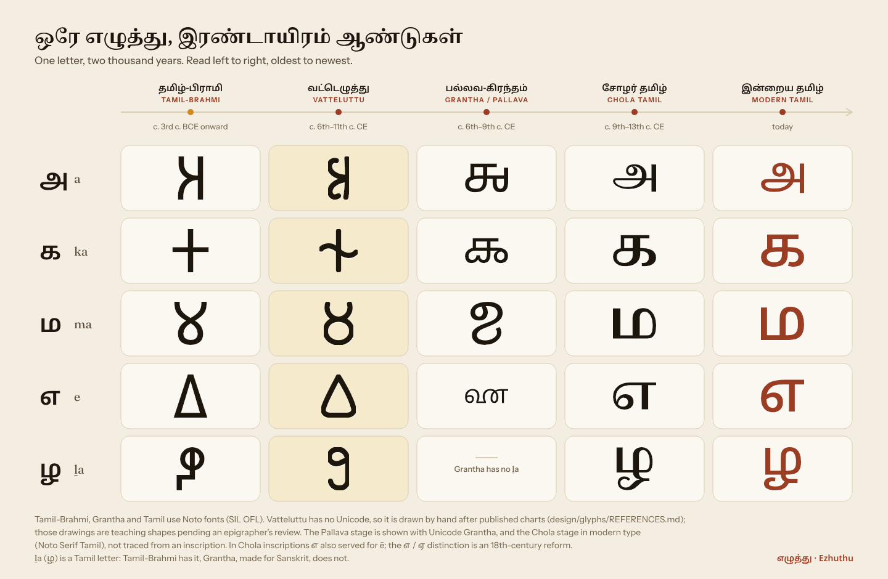

# Era glyphs: sources and status

`evolution-strip-{light,dark}.svg` shows the letters **a (அ), ka (க), ma (ம), e (எ), ḻa (ழ)** in five stages, oldest on the left. These are the stages the app uses (`L5` to `L1` in `contracts/restore-api.md`).

| Stage | How it is drawn | Status |
| --- | --- | --- |
| Tamil-Brahmi (c. 3rd c. BCE onward) | Noto Sans Brahmi, Unicode Brahmi block: 𑀅 U+11005, 𑀓 U+11013, 𑀫 U+1102B, 𑀏 U+1100F, and the Tamil-specific 𑀵 U+11035 (ḻa) | Unicode / Noto |
| Vatteluttu (c. 6th–11th c. CE) | **Hand-drawn** centre lines, 100 × 100 grid, round 8-unit stroke (`vatteluttu.json`, `vatteluttu/*.svg`) | Teaching approximation, **pending epigrapher review** |
| Grantha / Pallava (c. 6th–9th c. CE) | Noto Sans Grantha: 𑌅 U+11305, 𑌕 U+11315, 𑌮 U+1132E, 𑌏 U+1130F. Unicode Grantha has no ḻa (Grantha was made for Sanskrit, which has no ழ), so that cell is left empty on purpose. | Unicode / Noto. The Pallava-period Tamil hand itself has no Unicode encoding; Grantha is its closest encoded relative, as the app's L3 also assumes. |
| Chola Tamil (c. 9th–13th c. CE) | Noto Serif Tamil 600 | The letter shapes here are already close to modern ones. The differences that matter for reading (no *pulli*, older vowel signs, எ also standing for ē) are taught in lesson text, not in the glyph. |
| Modern Tamil | Noto Sans Tamil 500 | Unicode / Noto |

The periods are approximate and match `app/web/src/lib/levels.ts`. Note that the e/ē (எ/ஏ) and o/ō (ஒ/ஓ) distinction in writing is an 18th-century reform usually credited to C. J. Beschi.

## Vatteluttu: method and references

Vatteluttu ("round script") has no Unicode encoding, so there is no font. The drawings are **not traced from any single plate or inscription**. They are simplified teaching forms that follow the general letter shapes in published comparative palaeographic charts, and they keep the logic those charts show. Each Vatteluttu letter keeps its Tamil-Brahmi skeleton (column 1) and changes it in two ways: corners become curves, and strokes are joined in one rightward movement. For example, ka's Brahmi cross becomes a stem crossed by a wave, and e's triangle becomes a rounded triangle.

The sources used for the general forms:

1. Iravatham Mahadevan, *Early Tamil Epigraphy: From the Earliest Times to the Sixth Century A.D.* Chennai: Cre-A, and Cambridge MA: Harvard University (Harvard Oriental Series 62), 2003. The palaeography chapters and the letter-evolution charts from Tamil-Brahmi to early Vatteluttu.
2. T. V. Mahalingam, *Early South Indian Palaeography*. Madras: University of Madras, 1967 (2nd edn 1974). The comparative script tables.
3. C. Sivaramamurti, *Indian Epigraphy and South Indian Scripts*. Bulletin of the Madras Government Museum, New Series, General Section, Vol. III No. 4, 1952. The plates of South Indian alphabets.
4. "Vatteluttu alphabet", Wikipedia, and "Vatteluttu", Omniglot (omniglot.com). These are tertiary charts used only for cross-checking stroke order and orientation.

**Status and rules for use**

- Every drawn glyph is labelled "drawn glyph" in the UI (tooltip or caption). The app's About page already says the shapes are simplified.
- Do not present them as facsimiles of a dated inscription, and do not use them to read a real stone photograph.
- Corrections are welcome. To change a form, edit `design/tools/vatteluttu.py` (one path per letter), run `python design/tools/build_glyphs.py`, re-render, and note the source here. An epigrapher's review is tracked as a follow-up on issue #8.

## Files

| File | What it is |
| --- | --- |
| `vatteluttu.json` | `{stroke, viewBox, glyphs: {iso: {tamil, brahmi, d}}}`. The app maps `glyph_svg: "vatteluttu:<iso>"` to these. Keys: `a`, `ka`, `ma`, `e`, `ḻa`, `ta`, `pa`. |
| `vatteluttu/<key>.svg` | One file per glyph (ASCII file names: `lla.svg` is ḻa), `stroke="currentColor"`, ready to inline. |
| `evolution-strip-{light,dark}.svg` | The full chart (1440 × 940). PNGs are in `design/renders/glyphs/`. |
| `glyph-card-{light,dark}.svg` | A single glyph-card reference (spec in `GLYPH-CARD.md`). |
