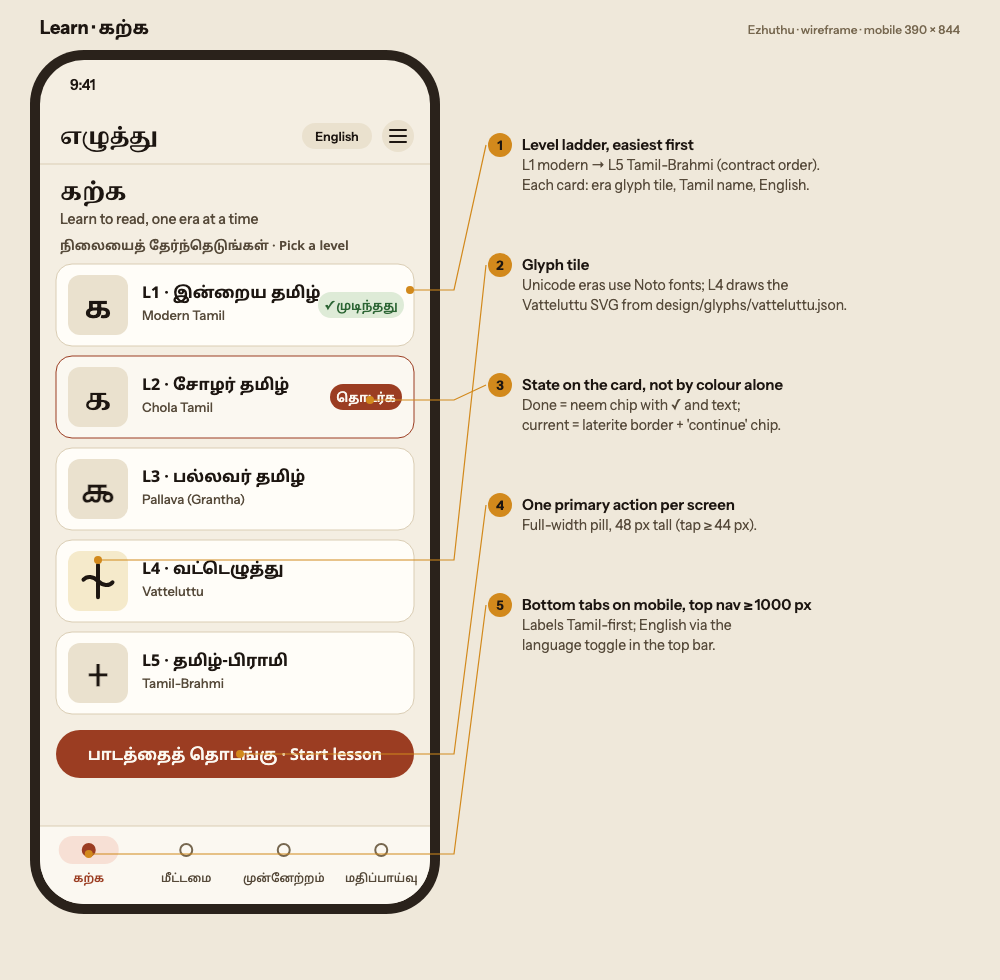
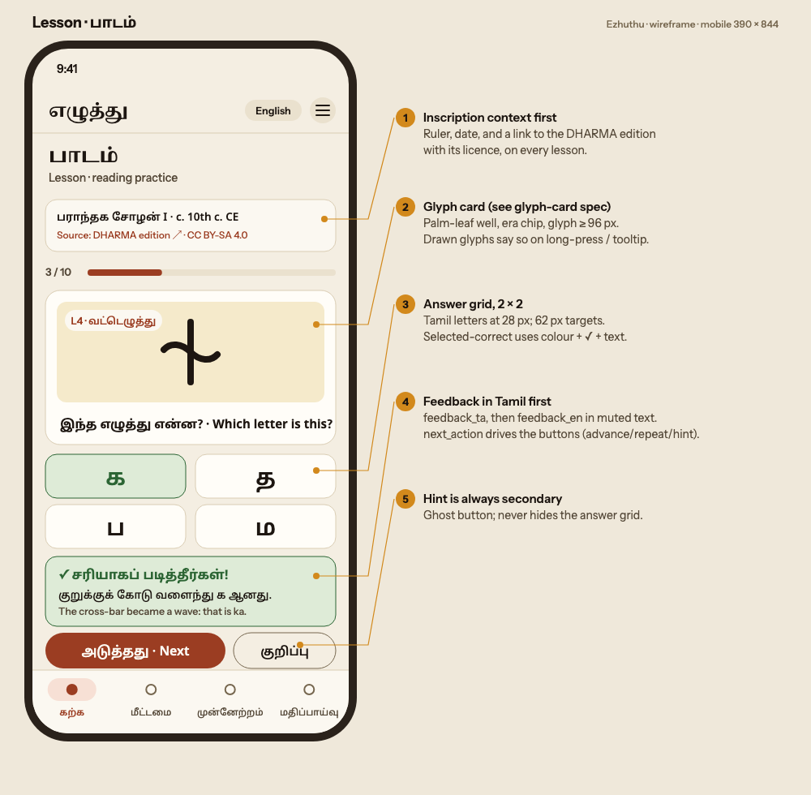
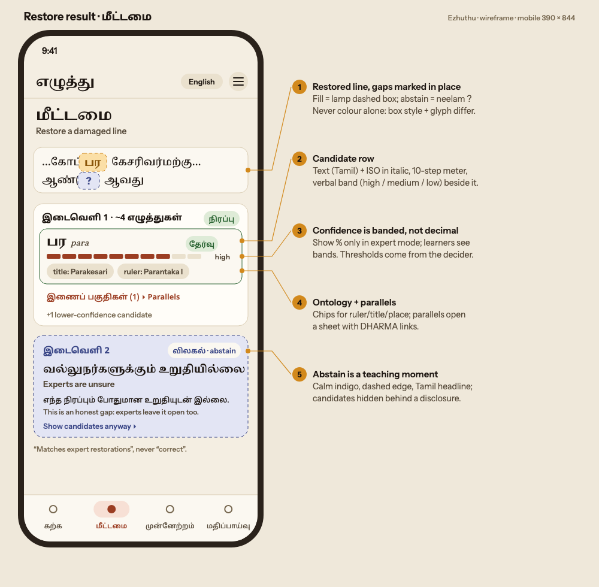
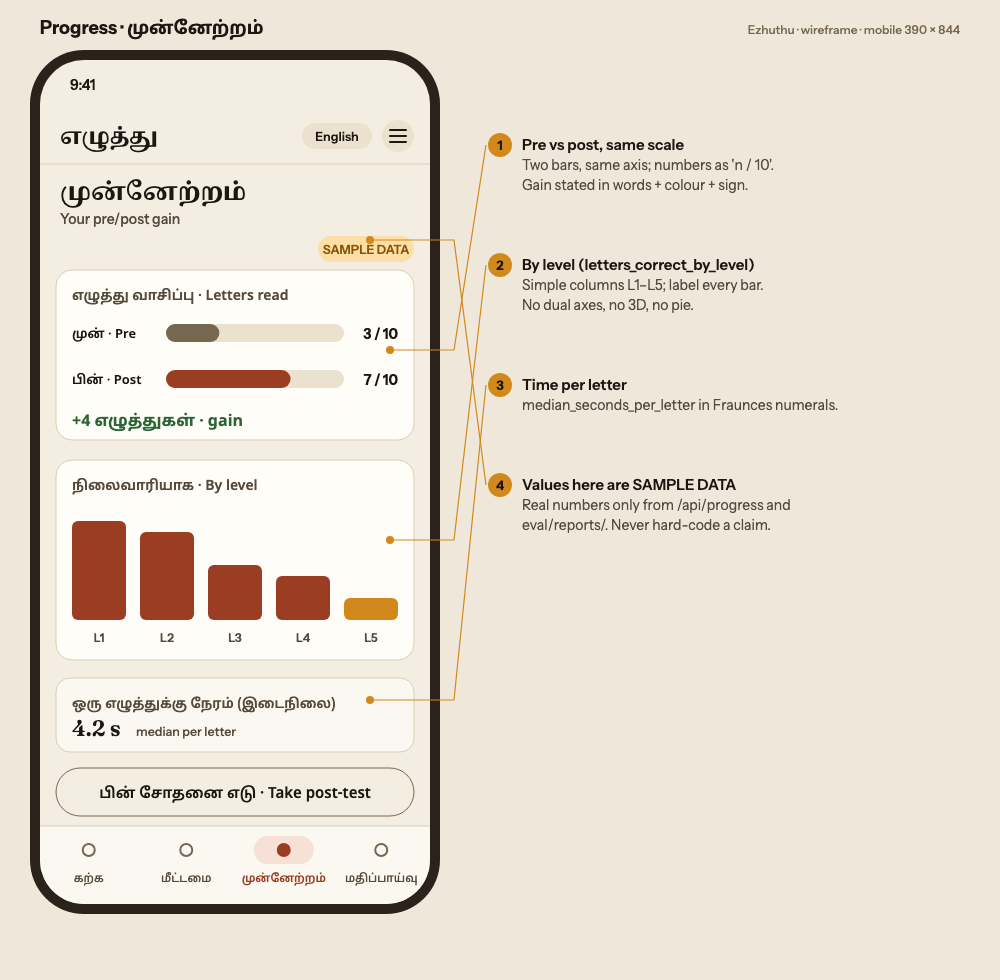
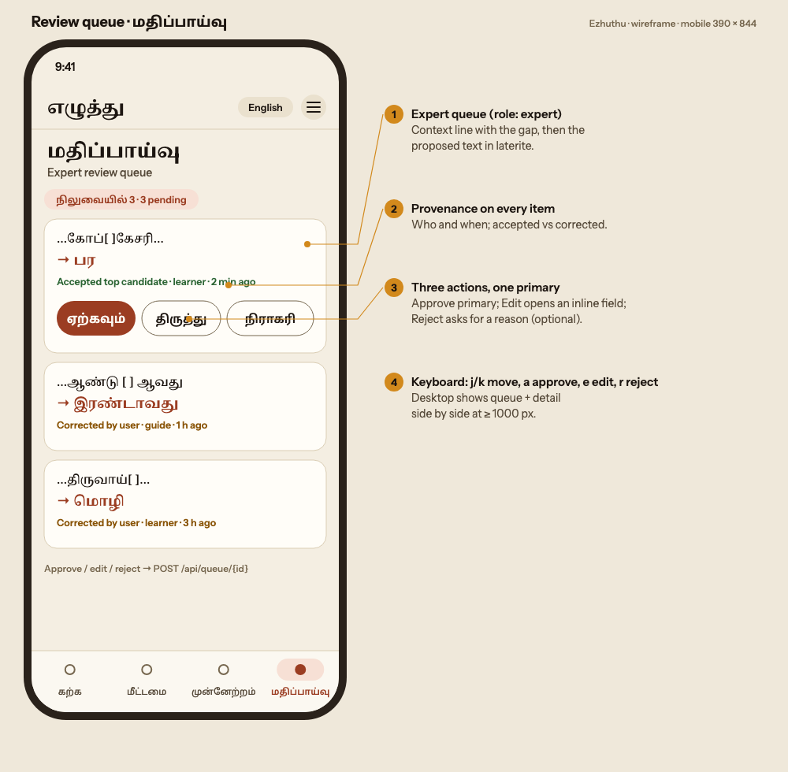
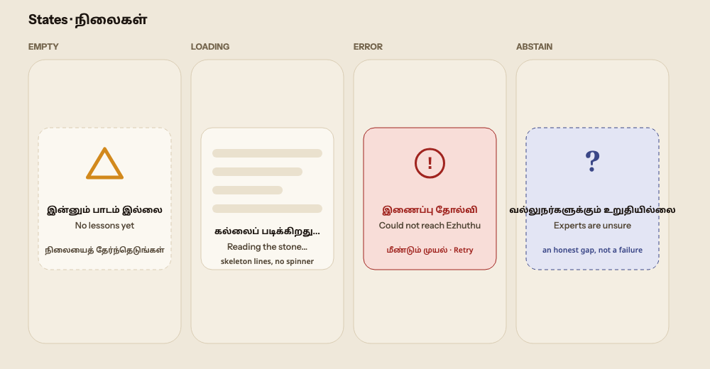

# Ezhuthu UX spec

For the app team (`u:app`, `app/web/`). Read this with `design/tokens/tokens.css`, `design/glyphs/GLYPH-CARD.md` and `contracts/restore-api.md`. Wireframes are in `wireframes/*.svg`, with PNG renders in `design/renders/ux/`.

## 1. Principles

1. **Tamil first.** Every screen works fully in Tamil. English is a toggle, never a requirement.
2. **Honest uncertainty.** An abstain is a teaching moment, not an error. A restoration "matches expert restorations"; it is never "correct".
3. **One thing to look at.** Each screen has one primary action and one lamp-coloured focus (the gap, the glyph, the gain).
4. **Material, not decoration.** Use stone, palm leaf and carved letters. No gradients on text, no glassmorphism, no "AI sparkle".
5. **Every number is sourced.** Progress numbers come from `/api/progress`. Claims in marketing copy come from `eval/reports/` or `benchmark/DATA_CARD.md`.

## 2. Information architecture

| Route (app today) | Tamil label | English | Who | API |
| --- | --- | --- | --- | --- |
| `/` | முகப்பு | Home | all | none |
| `/learn` | கற்க | Learn | learner, guide | `POST /api/lesson`, `POST /api/answer` |
| `/test` | சோதனை | Test (pre/post) | learner | `POST /api/assessment`, `POST /api/answer` |
| `/restore` | மீட்டமை | Restore | guide, expert | `POST /api/restore`, `POST /api/corrections` |
| `/progress` | முன்னேற்றம் | Progress | learner | `GET /api/progress/{session_id}` |
| `/review` | மதிப்பாய்வு | Review queue | expert | `GET /api/queue`, `POST /api/queue/{id}` |
| `/about` | அறிமுகம் | About, credits, DHARMA | all | none |

Navigation: below 1000 px, a **bottom tab bar** (Learn, Restore, Progress, Review) plus a menu for Test, About and the language toggle. At 1000 px and wider, a top nav as the app has now. Review is shown only to signed-in experts.

## 3. User flows

**Learner (student, self-learner)**
Home → *Start learning* → **pre-test** (10 era letters, untimed but timed silently) → pick a level (L1 suggested) → Lesson: inscription context → glyph question → feedback in Tamil → `next_action` (advance / repeat / hint) → … → **post-test** → Progress (pre vs post, gain, time per letter).

**Heritage guide (near a monument)**
Home → Restore → paste a line or pick a sample → restored line with gaps marked → open a gap → candidates, parallels (with DHARMA links), ontology chips (ruler, temple, grant) → "Explain to a visitor" (lesson context in Tamil) → optionally submit a correction.

**Expert (epigrapher, reviewer)**
Sign in → Review queue → item: the context line with the gap, the proposed text, its provenance → approve / edit / reject. On desktop, the queue and the detail sit side by side, with keyboard shortcuts j/k to move and a/e/r to approve, edit or reject.

## 4. Key screens

| Screen | Wireframe | Notes |
| --- | --- | --- |
| Learn |  | A level ladder, easiest first. Each card shows an era glyph tile, the Tamil name and the English name, and its state is shown as text plus colour. |
| Lesson |  | Context (ruler, date, DHARMA source and licence) → progress `n / 10` → glyph card → 2 × 2 answers → Tamil feedback → Next / Hint. |
| Restore result |  | The line with gaps marked in place, then one card per gap. Candidates show a 10-step meter plus a verbal band. Abstain gets an indigo card. |
| Progress |  | Pre and post on the same axis, the gain in words, by-level columns, and median time per letter. |
| Review queue |  | Provenance on every item. Approve is primary; Edit and Reject are secondary. |
| States |  | Empty, loading, error and abstain (section 6). |

## 5. Components

| Component | Spec |
| --- | --- |
| **Glyph card / tile** | `design/glyphs/GLYPH-CARD.md` |
| **Level ladder card** | Height 82, `surface-raised`, `radius-lg`. Current level: `accent` border plus a "தொடர்க" chip. Done: a neem chip "✓ முடிந்தது". Glyph tile 60 × 60. |
| **Button** | Pill, min-height 44 (48 for the primary on mobile). Primary: `accent` / `on-accent`, hover `accent-hover`. Ghost: transparent with a `border-strong` border. Tamil label first, English after a middle dot only when space allows. |
| **Chip** | 26 px tall, pill, xs/600. Variants: ok, unsure, lamp, error, neutral (`surface-sunk` / `text-muted`). |
| **Gap marker (inline)** | Fill: `lamp-soft` background, 1.5 px dashed `lamp` border, the text in `lamp-text`. Abstain: `unsure-soft`, dashed `unsure` border, "?". Unknown-length gaps `[?]` show "…?…". |
| **Confidence meter** | 10 segments of 8 px with a 3 px gap, filled in `accent`. Always followed by a word: **high** (≥ the decider's fill threshold), **medium**, **low**. Learners see the word and the meter only; expert mode adds the % (`confidence × 100`, rounded). Take thresholds from the decider; never hard-code them in the UI. |
| **Candidate row** | Tamil text (Noto Serif Tamil 700, 1.4rem) + ISO (Fraunces italic) + meter + model chip (sonnet / opus / retrieval) + "chosen" chip. The chosen row gets an `ok` border. |
| **Abstain card** | `unsure-soft` background, 1.5 px dashed `unsure` border, `radius-lg`. Headline "வல்லுநர்களுக்கும் உறுதியில்லை" (Noto Serif Tamil 700), sub-line "Experts are unsure", one sentence of explanation, and a disclosure "Show candidates anyway". |
| **Feedback** | `ok-soft` / `ok` for correct, `error-soft` / `error` for incorrect, `lamp-soft` for a hint. `feedback_ta` first (md/600), then `feedback_en` in `text-muted` sm. |
| **Inscription context** | A one-line card: ruler · approximate date (always "c."), and below it "Source: DHARMA edition ↗ · CC BY-SA 4.0" linked to `source_url`. |
| **Progress bars** | Same axis for pre and post, labelled "n / 10", gain stated as "+n எழுத்துகள்". No pie charts, no dual axes. |
| **Palm-leaf panel** | Keep the app's `.leaf.holes` motif for teaching panels. Background `leaf`, edge `leaf-edge`. |

## 6. States

| State | Pattern | Copy (ta / en) |
| --- | --- | --- |
| Empty | A dashed `border` card with the lamp triangle outline (the Brahmi e). | இன்னும் பாடம் இல்லை / No lessons yet. Then one action. |
| Loading | Skeleton lines in `surface-sunk`, no spinner. After 2 s, show "கல்லைப் படிக்கிறது…" / "Reading the stone…". Restorations can take a while, so stream gaps as they arrive when possible. | |
| Error | `error-soft` card, "!" icon, a retry button. Never show stack traces; show `trace_id` in small text for support. | இணைப்பு தோல்வி / Could not reach Ezhuthu |
| Abstain | The abstain card (section 5). Not an error and not red. | வல்லுநர்களுக்கும் உறுதியில்லை / Experts are unsure |
| Offline | The top bar shows a `lamp` chip "ஆஃப்லைன்", and lessons already loaded keep working. | |
| Mock mode | The app's striped banner stays (it is useful), recoloured with `lamp-soft` and `lamp-text`. | |

## 7. Layout and responsiveness (mobile first)

- Design width: **390 px**. Side gutter 16 px (`--ez-space-gutter`), or 28 px from 720 px. No horizontal scroll at any width.
- Breakpoints: **560** (show the English brand name), **720** (wider gutters), **760** (2- and 3-column grids), **1000** (top nav replaces bottom tabs; Review splits into two panes).
- Maximum content width 1120 px. Reading measure: 60ch for Tamil, 68ch for Latin.
- The bottom tab bar respects `env(safe-area-inset-bottom)`.
- Tap targets ≥ 44 × 44 px, with ≥ 8 px between them.

## 8. Bilingual rules

- `<html lang="ta">` by default. Set `lang="en"` on English spans and `lang="ta-Latn"` on ISO transliteration, so screen readers switch voice.
- Labels: Tamil first, then English after " · " only where the English helps (titles, primary CTAs on Home). Inside a lesson, English appears as secondary text (`text-muted`, one size down).
- Numerals: Western digits (0–9) in both languages. Dates: "கி.பி. 10ஆம் நூ. (ஏறத்தாழ)" / "c. 10th c. CE".
- Never truncate Tamil with an ellipsis mid-cluster. Wrap instead (`overflow-wrap: anywhere` only on code and ISO).
- Tamil line heights come from the tokens (`--ez-lh-*-ta`). Tamil headings are one step smaller than Latin ones.
- The language toggle keeps your place (the same route and the same item).

## 9. Accessibility

- WCAG 2.2 AA. All text pairs are checked in `design/tokens/CONTRAST.md`.
- `text-faint` goes only on `bg`, `surface` or `surface-raised`. On sunk, leaf (palm-leaf) and tinted surfaces use `text-muted`: `text-faint` drops below 4.5:1 there (see "Restricted pairs" in CONTRAST.md).
- Focus: a 3 px `--ez-focus` outline with a 2 px offset. It is never removed.
- State is never shown by colour alone: correct gets ✓ and text, abstain gets "?" and a dashed edge, a chosen candidate gets a "chosen" chip.
- Glyph images: `role="img"`, with an `aria-label` giving the era and letter, or "answer hidden".
- The confidence meter: `role="meter"` with `aria-valuemin=0`, `aria-valuemax=10` and `aria-valuetext="high"`.
- Motion: everything uses the token durations, which drop to 0 under `prefers-reduced-motion`. The home frieze animation stops under that setting.
- Feedback regions use `aria-live="polite"`, and errors use `role="alert"`.
- Keyboard: the answer grid is reachable with arrow keys (1–4 select an answer), and the review queue has the shortcuts from section 3.
